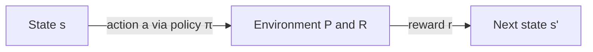

# Unit 1 — Introduction and Fundamentals of RL

**Priority: HIGH (detailed prep recommended).** Mid-1 asked 5 questions from this unit (MDP, Policy/Value Iteration, TD Learning, State/Action Value Functions, Bellman equation).

Syllabus topics: Overview of RL (foundational ideas, history, books, neuroscience, biological systems, industrial applications, research demonstrations) · MDPs · Bellman equations · Policy iteration & value iteration · Temporal Difference learning.

---

## 1. Overview of Reinforcement Learning

### A. Definition
**Reinforcement Learning (RL)** is a branch of machine learning in which an **agent** learns to take sequential **actions** in an **environment** by trial and error so as to maximise the **cumulative reward** it receives over time.

### B. Simple Explanation
Think of training a dog: no one tells the dog the "correct" move for each situation. It tries things, gets a treat (reward) or nothing, and slowly learns which behaviour pays off. RL does the same with software.

### C. Detailed Explanation
**Key elements**

| Element | Meaning |
|---|---|
| Agent | The learner / decision-maker |
| Environment | Everything the agent interacts with |
| State (s) | Description of the current situation |
| Action (a) | Choice made by the agent |
| Reward (r) | Scalar feedback after an action |
| Policy (π) | Mapping from states to actions |
| Value function (V, Q) | Expected long-term return |
| Model (optional) | Agent's prediction of next state and reward |

**Characteristics:** trial-and-error search · delayed reward · sequential decisions · exploration vs exploitation trade-off · no labelled data.

### D. Diagram (agent–environment loop)
```
        action a_t
   +-------------------->+
   |                     |
+--+----+          +-----v-----+
| AGENT |          |ENVIRONMENT|
+--^----+          +-----+-----+
   |  state s_{t+1}      |
   +<--------------------+
   |  reward r_{t+1}     |
   +<--------------------+
```

### E. Comparison: Supervised vs Unsupervised vs RL

| Feature | Supervised | Unsupervised | Reinforcement |
|---|---|---|---|
| Feedback | Correct labels | None | Reward signal |
| Goal | Predict labels | Find structure | Maximise cumulative reward |
| Data | Fixed i.i.d. dataset | Fixed dataset | Generated by agent's own actions |
| Feedback timing | Immediate | — | Often delayed |
| Example | Spam detection | Clustering | Game playing, robotics |

### History (timeline)
| Period | Milestone |
|---|---|
| 1911 | Thorndike's **Law of Effect** (trial-and-error learning in animals) |
| 1950s | Bellman: **Dynamic Programming** and MDPs (optimal control thread) |
| 1950s–60s | Samuel's checkers program (learning by self-play) |
| 1988 | Sutton: **Temporal Difference learning** |
| 1989 | Watkins: **Q-learning** |
| 1992 | Tesauro's **TD-Gammon** (backgammon) |
| 2013–15 | DeepMind **DQN** plays Atari from pixels |
| 2016–17 | **AlphaGo / AlphaZero** |
| 2022 onward | **RLHF** used to align LLMs (InstructGPT, ChatGPT) |

Two classic threads merged to form modern RL: **trial-and-error learning** (psychology) and **optimal control / dynamic programming** (mathematics).

### Standard books
- Sutton & Barto — *Reinforcement Learning: An Introduction* (the main textbook)
- Bertsekas & Tsitsiklis — *Neuro-Dynamic Programming*
- Szepesvári — *Algorithms for Reinforcement Learning*
- Bertsekas — *Dynamic Programming and Optimal Control*

### Connection to neuroscience and biological systems
- **Dopamine neurons** fire in proportion to a **reward prediction error**, which closely matches the **TD error** δ (Schultz, Dayan & Montague, 1997).
- Animal conditioning (Pavlov – classical, Skinner – operant) corresponds to prediction and control in RL; the Rescorla–Wagner model is an early form of TD-style learning.
- The **basal ganglia** is often modelled as an actor–critic system.

### Industrial applications
Data-centre cooling energy saving, recommendation and ad bidding, robotics and warehouse automation, chip floor-planning, traffic-signal control, supply chain/inventory, finance (portfolio, execution), LLM alignment (RLHF).

### Research demonstrations
Atari games (DQN), Go (AlphaGo/AlphaZero), Dota 2 (OpenAI Five), StarCraft II (AlphaStar), robotic hand solving Rubik's cube, plasma control in fusion reactors, matrix-multiplication algorithm discovery (AlphaTensor).

### G. University Examination Answer — "Overview of RL"
1. **Definition** (above).
2. **Components** – agent, environment, state, action, reward, policy, value function, model.
3. **Diagram** – agent–environment loop.
4. **Working** – at each step agent observes s_t → picks a_t using policy → environment returns r_{t+1}, s_{t+1} → agent updates policy to maximise return.
5. **Applications** – games, robotics, recommender systems, data-centre control, RLHF.
6. **Conclusion** – RL suits sequential decision problems where no labelled correct action exists.

### H. Keywords
Agent, environment, reward, return, policy, value function, trial-and-error, delayed reward, exploration–exploitation, Sutton & Barto, dopamine / TD error, Law of Effect.

---

## 2. Markov Decision Process (MDP)  ⭐ Priority 1 (Mid-1 Q1a)

### A. Definition
An **MDP** is a mathematical framework for sequential decision-making, defined by the tuple **(S, A, P, R, γ)**, in which the next state depends only on the current state and action (**Markov property**).

### B. Simple Explanation
It is a "game board" description: where you can be (states), what you can do (actions), where you land (transition probabilities), what you earn (rewards), and how much you care about the future (discount).

### C. Elements of an MDP

| Element | Symbol | Description |
|---|---|---|
| State space | S | Set of all possible states |
| Action space | A (or A(s)) | Set of actions available |
| Transition function | P(s′ \| s,a) | Probability of reaching s′ from s after a |
| Reward function | R(s,a) or R(s,a,s′) | Expected immediate reward |
| Discount factor | γ ∈ [0,1] | Weight of future rewards |
| (Policy) | π(a \| s) | Behaviour of the agent |

**Markov property:** P(s_{t+1} | s_t, a_t, s_{t-1}, …) = P(s_{t+1} | s_t, a_t)

**Return:** G_t = r_{t+1} + γ r_{t+2} + γ² r_{t+3} + … = Σ_k γ^k r_{t+k+1}

**Types:** finite vs infinite MDP · episodic vs continuing tasks · deterministic vs stochastic transitions.

**Goal:** find policy π* maximising expected return E[G_t].

### D. Diagram
```
 s_t --a_t--> [ P(s'|s,a) ] --> s_{t+1}, r_{t+1}
   ^                                  |
   +------------- policy π -----------+
```
Mermaid version:


### F. Example
**Grid-world robot:** states = cells, actions = {up, down, left, right}, reward −1 per step and +10 at goal, P = 0.8 intended move / 0.1 slip each side, γ = 0.9.

### G. University Examination Answer
1. Definition + tuple (S,A,P,R,γ).
2. Table of elements (with symbols).
3. Markov property equation.
4. Return and discounting; role of γ (γ→0 myopic, γ→1 far-sighted).
5. Goal: optimal policy π*.
6. Grid-world example, applications (robot navigation, inventory control).

### H. Keywords
Markov property, state, action, transition probability, reward function, discount factor γ, return, policy, episodic/continuing.

---

## 3. Policy, Value Functions and Bellman Equations  ⭐ Priority 1 (Mid-1 Q2a, Q2b)

### A. Definitions
- **Policy π(a|s):** probability of choosing action a in state s.
- **State-value function v_π(s):** expected return starting in s and following π.
  v_π(s) = E_π[ G_t | S_t = s ]
- **Action-value function q_π(s,a):** expected return starting in s, taking a, then following π.
  q_π(s,a) = E_π[ G_t | S_t = s, A_t = a ]

### B. Simple Explanation
v(s) answers "how good is it to be here?"; q(s,a) answers "how good is it to do this action here?".

### C. Relationship

- v_π(s) = Σ_a π(a|s) q_π(s,a)
- q_π(s,a) = Σ_{s′} P(s′|s,a) [ R(s,a) + γ v_π(s′) ]

### Bellman Expectation Equation
**v_π(s) = Σ_{a∈A} π(a|s) Σ_{s′∈S} P(s′|s,a) [ R(s,a) + γ v_π(s′) ]**

*Reading:* average over actions (weighted by policy) → average over next states (weighted by dynamics) → immediate reward plus discounted value of the next state.

**q_π(s,a) = Σ_{s′} P(s′|s,a) [ R(s,a) + γ Σ_{a′} π(a′|s′) q_π(s′,a′) ]**

### Bellman Optimality Equations
- v*(s) = max_a Σ_{s′} P(s′|s,a) [ R(s,a) + γ v*(s′) ]
- q*(s,a) = Σ_{s′} P(s′|s,a) [ R(s,a) + γ max_{a′} q*(s′,a′) ]
- π*(s) = argmax_a q*(s,a)

### D. Backup diagram (for v_π)
```
        (s)            <- root: state
       / | \           <- actions weighted by π(a|s)
     (a1)(a2)(a3)
     / \
  (s'1)(s'2)           <- next states weighted by P(s'|s,a), reward r
```

### E. State value vs Action value

| Basis | v_π(s) | q_π(s,a) |
|---|---|---|
| Input | state | state + action |
| Meaning | value of being in s under π | value of taking a in s, then π |
| Needed for control? | needs a model to pick actions | can pick action directly (argmax) |
| Used in | policy evaluation, TD(0) | Q-learning, SARSA |

### G. University Examination Answer — "Explain the Bellman equation V^π(s) = …"
Write: define symbols (π(a|s), P(s′|s,a), R(s,a), γ, V^π(s′)) → state it is the **Bellman expectation equation** → explain the nested averaging → say it gives a **recursive** definition of value, solved by iterative policy evaluation or as a linear system (V = R + γPV) → mention Bellman optimality as the max version.

### H. Keywords
Bellman equation, recursion, expectation, backup, optimal value function, argmax, policy evaluation.

---

## 4. Policy Iteration and Value Iteration  ⭐ Priority 1 (Mid-1 Q1b)

### A. Definition
Both are **Dynamic Programming** algorithms that compute the optimal policy of a known MDP (model-based).

### B. Simple Explanation
- **Policy iteration:** evaluate the current policy fully, then improve it, and repeat.
- **Value iteration:** directly keep improving the value estimates with the "max" rule; read off the policy at the end.

### C. Policy Iteration
1. **Initialise** π and V arbitrarily.
2. **Policy evaluation:** repeat until convergence
   V(s) ← Σ_a π(a|s) Σ_{s′} P(s′|s,a)[R + γV(s′)]
3. **Policy improvement:**
   π′(s) = argmax_a Σ_{s′} P(s′|s,a)[R + γV(s′)]
4. If π′ = π stop, else go to step 2.

```
 π0 --evaluate--> v_π0 --improve--> π1 --evaluate--> v_π1 --> ... --> π*, v*
```

### Value Iteration
V_{k+1}(s) = max_a Σ_{s′} P(s′|s,a)[R(s,a) + γV_k(s′)]
Repeat until max_s |V_{k+1}(s) − V_k(s)| < θ; then π*(s) = argmax_a Σ_{s′} P(s′|s,a)[R + γV(s′)].

### E. Comparison

| Aspect | Policy Iteration | Value Iteration |
|---|---|---|
| Update rule | Bellman expectation (follows π) | Bellman optimality (max) |
| Per-iteration cost | High (full evaluation) | Low (one sweep) |
| Number of iterations | Few | Many |
| Policy available | At every iteration | Only extracted at end |
| Convergence | Guaranteed (finite MDP) | Guaranteed (γ<1, contraction) |
| Requirement | Known model P, R | Known model P, R |

### G. University Examination Answer
Intro (DP, known model) → Policy iteration (steps + equations + diagram) → Value iteration (equation + stopping rule) → comparison table → note both converge to π*, limitation: need full model and small state space (curse of dimensionality) → conclusion.

### H. Keywords
Dynamic programming, policy evaluation, policy improvement, greedy policy, Bellman optimality, contraction mapping, convergence threshold θ.

---

## 5. Temporal Difference (TD) Learning  ⭐ Priority 1 (Mid-1 Q1c)

### A. Definition
**TD learning** is a model-free method that learns value functions by **bootstrapping**: it updates the estimate of a state using the observed reward plus the current estimate of the next state, after every step.

### B. Simple Explanation
Instead of waiting for the game to end (Monte Carlo), you correct your guess *now* using the next guess. "Guess from a guess."

### C. TD(0) update
**V(s_t) ← V(s_t) + α [ r_{t+1} + γ V(s_{t+1}) − V(s_t) ]**

- TD target = r_{t+1} + γV(s_{t+1})
- **TD error** δ_t = r_{t+1} + γV(s_{t+1}) − V(s_t)
- α = learning rate

### Two (main) TD control methods
1. **SARSA (on-policy):** Q(s,a) ← Q(s,a) + α[ r + γ Q(s′,a′) − Q(s,a) ] where a′ is chosen by the *same* (ε-greedy) policy. Name = (S, A, R, S′, A′).
2. **Q-learning (off-policy):** Q(s,a) ← Q(s,a) + α[ r + γ max_{a′} Q(s′,a′) − Q(s,a) ]
(Other TD variants: TD(λ) with eligibility traces, n-step TD.)

### E. Comparison: DP vs Monte Carlo vs TD

| Feature | DP | Monte Carlo | TD |
|---|---|---|---|
| Needs model? | Yes | No | No |
| Bootstraps? | Yes | No | Yes |
| Updates | Full sweeps | End of episode | Every step |
| Variance | — | High | Low |
| Bias | None | None | Some |
| Works on continuing tasks | Yes | No | Yes |

### F. Example
Driving home: initial estimate 30 min. After the first stretch you note 5 min elapsed and new estimate 28 total → TD error uses the revised estimate immediately, not the final arrival time.

### G. University Examination Answer
Definition → bootstrapping idea → TD(0) update + TD error → two methods (SARSA, Q-learning with equations) → table vs MC/DP → advantages (online, model-free, lower variance) / disadvantages (bias, sensitive to α) → neuroscience link (dopamine) → conclusion.

### H. Keywords
Bootstrapping, TD error δ, TD target, on-policy, off-policy, SARSA, Q-learning, eligibility trace, TD(λ), model-free.

---

## Unit 1 — Quick Revision (2-mark ready)
- **RL:** learning by interaction to maximise cumulative reward.
- **MDP:** (S,A,P,R,γ) with Markov property.
- **Return:** G_t = Σ γ^k r_{t+k+1}.
- **Policy iteration:** evaluate ↔ improve. **Value iteration:** Bellman max update.
- **TD(0):** V ← V + α[r + γV′ − V].
- **Bellman equation:** recursive relation of a state's value with successor values.
