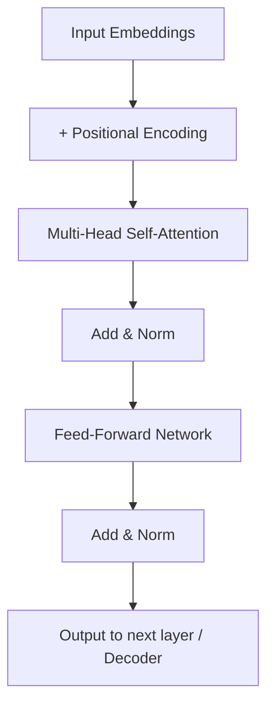
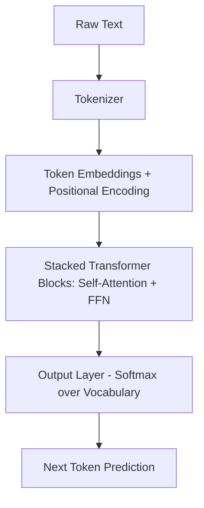
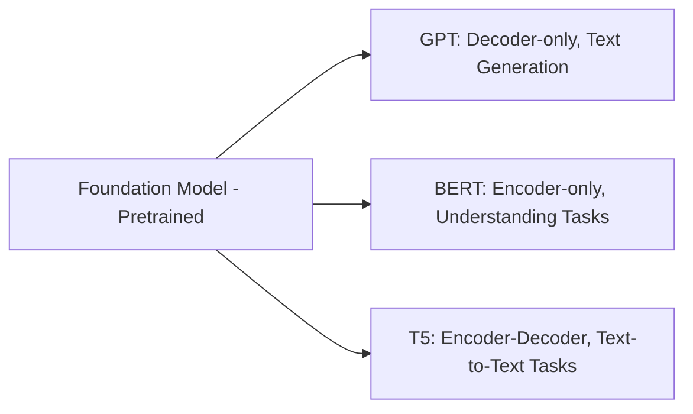
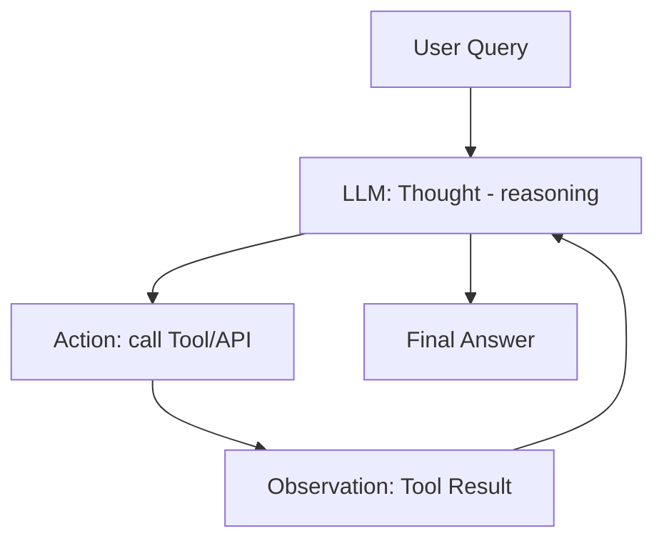

# UNIT I – Text Generation & Language Models

> **Syllabus coverage:** RNN, LSTM, Transformer-based language models; Decoding strategies (sampling, beam search); Pre-training & fine-tuning; Foundation models (GPT, T5, BERT); Applications (chatbots, text completion, summarization); LLM Agents & Tools (LangChain, AutoGen, ReAct framework); Evaluation techniques (BLEU, ROUGE, BERTScore, factuality/hallucination metrics); Industry use cases (customer support, document automation, voice assistants with OpenAI, Cohere, Mistral APIs).

**Exam weightage in this unit:** 🔴 **Priority 1 (Very Important)** — this is one of the most frequently tested units across all four supplied papers. Transformers, decoding strategies, LLM agents, RNN/LSTM, and pre-training/fine-tuning appear repeatedly in different wordings.

---

## 1. Introduction to RNN, LSTM, and Transformer-based Language Models

### A. Definition
A **Recurrent Neural Network (RNN)** is a class of neural networks designed to process sequential data by maintaining a hidden state that captures information from previous time steps, allowing the network to exhibit temporal dynamic behavior.

A **Long Short-Term Memory (LSTM)** network is a special type of RNN architecture that uses gating mechanisms (input, output, and forget gates) to control the flow of information, thereby solving the vanishing gradient problem and enabling learning of long-range dependencies.

A **Transformer** is a deep learning architecture introduced in "Attention Is All You Need" (2017) that relies entirely on the self-attention mechanism to model relationships between tokens in a sequence, without using recurrence or convolution.

### B. Simple Explanation
Think of reading a sentence word by word. An RNN reads one word at a time and carries a "memory" of what it read before to the next step — but this memory fades quickly over long sentences (like a game of telephone). LSTM fixes this by adding "gates" that decide what to remember, what to forget, and what to output, so it can carry memory over much longer sentences. A Transformer takes a completely different approach: instead of reading word by word, it looks at **all words at once** and figures out which words are related to which other words using "attention" — much faster to train and much better at capturing long-range relationships.

### C. Detailed Explanation

**RNN – Working Principle:**
- At each time step `t`, the RNN takes an input `x_t` and the previous hidden state `h_(t-1)`, and computes a new hidden state: `h_t = tanh(W_hh·h_(t-1) + W_xh·x_t + b)`.
- The hidden state acts as a "memory" passed forward through the sequence.
- Output at each step can be produced from `h_t`.

**RNN – Limitations:**
- **Vanishing/Exploding Gradients:** During backpropagation through time (BPTT), gradients multiply repeatedly, causing them to shrink toward zero (vanishing) or grow uncontrollably (exploding), making it hard to learn long-range dependencies.
- Sequential computation prevents parallelization, making training slow.

**LSTM – Architecture and Components:**
An LSTM cell has three gates and a cell state:
1. **Forget Gate (`f_t`):** Decides what information to discard from the cell state. `f_t = σ(W_f·[h_(t-1), x_t] + b_f)`
2. **Input Gate (`i_t`):** Decides what new information to add. `i_t = σ(W_i·[h_(t-1), x_t] + b_i)`
3. **Candidate Cell State:** `C̃_t = tanh(W_C·[h_(t-1), x_t] + b_C)`
4. **Cell State Update:** `C_t = f_t * C_(t-1) + i_t * C̃_t`
5. **Output Gate (`o_t`):** Decides what to output. `o_t = σ(W_o·[h_(t-1), x_t] + b_o)`; `h_t = o_t * tanh(C_t)`

The cell state `C_t` acts as a "conveyor belt" that carries long-term information with minimal modification, which is why LSTMs handle long sequences better than vanilla RNNs.

**Transformer – Architecture and Components:**
1. **Input Embedding + Positional Encoding:** Since Transformers have no recurrence, positional encodings are added to embeddings to inject word-order information.
2. **Self-Attention Mechanism:** Computes a weighted representation of each token based on its relationship to every other token using **Query (Q), Key (K), Value (V)** vectors:
   `Attention(Q,K,V) = softmax(QK^T / √d_k) · V`
3. **Multi-Head Attention:** Runs several attention operations ("heads") in parallel, each learning different types of relationships, then concatenates the results.
4. **Feed-Forward Network (FFN):** A position-wise fully connected network applied after attention.
5. **Add & Norm (Residual Connections + Layer Normalization):** Stabilizes training and helps gradients flow.
6. **Encoder-Decoder Structure:** The encoder processes the input sequence; the decoder generates the output sequence using masked self-attention and cross-attention to the encoder's output.

**Relevance in Generative AI:** Transformers form the backbone of virtually all modern LLMs (GPT, BERT, T5) because self-attention captures long-range dependencies efficiently and allows full parallelization during training, unlike RNN/LSTM.

### D. Diagrams

**RNN unfolded through time:**
```
x1        x2        x3
 |         |         |
 v         v         v
[h0]-->[RNN]-->[h1]-->[RNN]-->[h2]-->[RNN]-->[h3]
          |              |              |
          v              v              v
         y1             y2             y3
```

**LSTM Cell:**
```
           Cell state (long-term memory)
   C(t-1) ----*-------------+----------> C(t)
              |             |
         [Forget Gate]  [Input Gate]x[Candidate]
              |             |
   h(t-1),x(t)---->[sigmoid/tanh gates]
                            |
                     [Output Gate]
                            |
                            v
                           h(t)
```

**Transformer Block (simplified, Mermaid):**


### E. Comparison Table

| Feature | RNN | LSTM | Transformer |
|---|---|---|---|
| Processing | Sequential, one step at a time | Sequential, one step at a time | Parallel, all tokens at once |
| Long-range dependency | Poor (vanishing gradient) | Good (gating mechanism) | Excellent (self-attention) |
| Training speed | Slow | Slower (more parameters) | Fast (parallelizable) |
| Memory mechanism | Single hidden state | Cell state + 3 gates | Attention weights (no explicit memory) |
| Positional info | Implicit via order of processing | Implicit via order of processing | Explicit positional encoding needed |
| Use in modern LLMs | Rare today | Occasionally (speech, small models) | Standard (GPT, BERT, T5) |

### F. Real-world Examples
- **RNN:** Early predictive text keyboards.
- **LSTM:** Google's earlier machine translation systems; speech recognition.
- **Transformer:** ChatGPT, Google BERT search ranking, Google Translate (current version).

### G. University Examination Answer — "What is RNN? Explain with its operational architecture. What is its relevance in GEN AI?"
1. **Definition:** An RNN is a neural network with loops that allow information to persist across time steps, enabling it to process sequential data such as text.
2. **Architecture:** Explain the unfolded diagram above — input `x_t`, hidden state `h_t`, recurrent weight `W_hh`, output `y_t`.
3. **Working:** At each step, combine current input with previous hidden state via `h_t = tanh(W_hh·h_(t-1) + W_xh·x_t)`; this hidden state is passed to the next step.
4. **Limitation:** Vanishing gradient problem limits long-sequence learning.
5. **Relevance in GenAI:** RNNs were the first neural architecture used for text generation and language modeling; they laid the conceptual foundation (sequence modeling, hidden state as memory) that later architectures like LSTM and Transformers improved upon.
6. **Conclusion:** Though largely replaced by Transformers in modern LLMs, RNNs remain foundational for understanding sequence modeling in Generative AI.

### H. Important Keywords
Hidden state, Backpropagation Through Time (BPTT), vanishing/exploding gradients, forget/input/output gate, cell state, self-attention, Query-Key-Value, multi-head attention, positional encoding, residual connection, layer normalization, encoder-decoder.

---

## 2. Attention Mechanism in Text GEN AI

### A. Definition
**Attention** is a mechanism that allows a model to dynamically focus on the most relevant parts of the input sequence when producing each part of the output, by computing a weighted sum of input representations where weights reflect relevance.

### B. Simple Explanation
When you read the sentence "The cat sat on the mat because **it** was tired," to understand what "it" refers to, your brain pays more attention to "cat" than to "mat." Attention mechanisms let the model do the same — mathematically scoring how much each word should "attend to" every other word.

### C. Detailed Explanation — How Attention is Calculated for a Token

**Step-by-step calculation (Scaled Dot-Product Attention):**
1. Each input token's embedding is projected into three vectors: **Query (Q)**, **Key (K)**, **Value (V)**, using learned weight matrices `W_Q`, `W_K`, `W_V`.
2. For a given token, compute the **dot product** of its Query vector with the Key vector of every other token: `score = Q · K^T`.
3. **Scale** the scores by dividing by `√d_k` (square root of key dimension) to prevent large values from destabilizing gradients.
4. Apply **softmax** to the scaled scores to get attention weights that sum to 1: `α = softmax(QK^T / √d_k)`.
5. Compute the **weighted sum** of Value vectors using these attention weights: `Attention(Q,K,V) = α · V`.
6. This produces a new representation of the token that incorporates contextual information from all other relevant tokens.

**Multi-Head Attention:** The above process is repeated in parallel with different learned projections ("heads"), allowing the model to capture different types of relationships (e.g., syntactic vs semantic) simultaneously. The outputs of all heads are concatenated and linearly transformed.

**Types of Attention:**
- **Self-Attention:** Query, Key, Value all come from the same sequence.
- **Cross-Attention:** Query comes from the decoder; Key/Value come from the encoder (used in encoder-decoder models).
- **Masked Self-Attention:** Used in decoders to prevent a token from attending to future tokens (causal masking).

### D. Diagram
```
Token embeddings: x1, x2, x3
         |
   [Linear projections]
         |
   Q1,K1,V1   Q2,K2,V2   Q3,K3,V3
         |
   score(i,j) = Qi · Kj^T / sqrt(d_k)
         |
     softmax(scores) --> attention weights
         |
   weighted sum of V --> contextual output for each token
```

### E. Comparison Table

| Attention Type | Q source | K, V source | Used in |
|---|---|---|---|
| Self-Attention | Same sequence | Same sequence | Encoder, Decoder |
| Cross-Attention | Decoder | Encoder | Encoder-Decoder models (T5) |
| Masked Self-Attention | Same sequence (future masked) | Same sequence | Decoder-only models (GPT) |

### F. Real-world Example
In translating "The animal didn't cross the street because it was too tired," attention weights help the model correctly link "it" to "animal" rather than "street" — critical for correct translation/understanding.

### G. University Examination Answer — "What is attention in Text GEN AI and explain how we calculate the attention of a given token?"
1. **Definition:** State the definition above.
2. **Why needed:** Overcomes RNN's limitation of forgetting distant context; lets every token directly access every other token.
3. **Calculation:** Walk through the 5-step Q, K, V → score → scale → softmax → weighted sum process (formula included).
4. **Diagram:** Include the diagram above.
5. **Extension:** Mention multi-head attention briefly.
6. **Conclusion:** Attention is the foundational mechanism enabling Transformers' superior performance in Generative AI text tasks.

### H. Important Keywords
Query, Key, Value, dot-product, scaling factor √d_k, softmax, attention weights, self-attention, cross-attention, masked attention, multi-head attention.

---

## 3. Large Language Models (LLM) and Their Components

### A. Definition
A **Large Language Model (LLM)** is a deep neural network, typically based on the Transformer architecture, trained on massive amounts of text data using self-supervised learning to predict and generate human-like text, often containing billions of parameters.

### B. Simple Explanation
An LLM is essentially a very large Transformer that has read huge portions of the internet and learned statistical patterns of language — enabling it to predict the next word in a sentence so well that it can write essays, answer questions, and hold conversations.

### C. Detailed Explanation — Components of an LLM
1. **Tokenizer:** Converts raw text into tokens (subwords/words) that the model can process (e.g., Byte Pair Encoding, WordPiece).
2. **Embedding Layer:** Converts tokens into dense numerical vectors.
3. **Positional Encoding:** Adds order information since Transformers process tokens in parallel.
4. **Transformer Blocks (stacked):** Each containing multi-head self-attention and feed-forward layers, repeated many times (e.g., GPT-3 has 96 layers).
5. **Output Layer (Softmax over vocabulary):** Produces a probability distribution over the vocabulary for the next token.
6. **Training Objective:** Typically next-token prediction (causal language modeling) or masked token prediction.

**Types of LLM architectures:**
- **Encoder-only** (e.g., BERT) — good for understanding/classification tasks.
- **Decoder-only** (e.g., GPT) — good for text generation.
- **Encoder-Decoder** (e.g., T5) — good for sequence-to-sequence tasks like translation/summarization.

### D. Diagram


### E. Comparison Table

| Architecture Type | Example | Best Suited For |
|---|---|---|
| Encoder-only | BERT | Classification, understanding, embeddings |
| Decoder-only | GPT | Text generation, chatbots |
| Encoder-Decoder | T5 | Translation, summarization |

### F. Real-world Example
ChatGPT (decoder-only GPT architecture) generates text one token at a time, predicting the next most probable token based on all previous tokens.

### G. University Examination Answer — "What is LLM and explain briefly the components of LLM"
1. **Definition** (as above).
2. **Components:** Tokenizer → Embeddings → Positional Encoding → Transformer blocks → Output layer (list and explain each briefly).
3. **Diagram** as above.
4. **Training approach:** Mention pre-training on large corpora + fine-tuning for specific tasks.
5. **Conclusion:** LLMs combine these components at massive scale to achieve general-purpose language understanding and generation.

### H. Important Keywords
Tokenizer, embedding layer, positional encoding, Transformer block, softmax output layer, causal language modeling, parameters, vocabulary.

---

## 4. Pre-Training and Fine-Tuning in Transformer-based Language Models

### A. Definition
**Pre-training** is the initial phase where a language model is trained on a large, general-purpose corpus using self-supervised objectives (e.g., next-token prediction or masked-token prediction) to learn general linguistic and world knowledge.

**Fine-tuning** is the subsequent phase where the pre-trained model is further trained on a smaller, task-specific or domain-specific labeled dataset to adapt its general knowledge to a particular task.

### B. Simple Explanation
Pre-training is like a student reading thousands of books to build general knowledge. Fine-tuning is like that student then taking a specialized course (e.g., medical training) to apply their general knowledge to a specific job.

### C. Detailed Explanation

**Pre-training:**
- Uses massive unlabeled text corpora (web pages, books, Wikipedia).
- Self-supervised objectives: **Causal Language Modeling** (predict next token — used by GPT) or **Masked Language Modeling** (predict masked tokens — used by BERT).
- Extremely computationally expensive (requires thousands of GPUs, weeks of training).
- Produces a general-purpose "foundation model."

**Fine-tuning:**
- Uses a smaller, labeled, task-specific dataset.
- Adjusts the pre-trained model's weights (fully or partially) to specialize it for tasks like sentiment analysis, summarization, or customer support.
- Much cheaper and faster than pre-training.
- Can be **full fine-tuning** (all parameters updated) or **parameter-efficient fine-tuning** (e.g., LoRA — covered in Unit III).

**Significance:**
- Pre-training provides broad language understanding and world knowledge, avoiding the need to train from scratch for every task.
- Fine-tuning allows customization, improves task-specific accuracy, and aligns the model's outputs with desired behavior (e.g., instruction-following, safety).
- This two-stage paradigm (pre-train then fine-tune) is the foundation of the modern "foundation model" approach in Generative AI.

### D. Diagram
```
[Massive Unlabeled Corpus] --> [Pre-training: Next-token / Masked-token prediction] --> [Foundation Model]
                                                                                              |
                                                                                              v
                                                                      [Small Labeled Task-Specific Data] --> [Fine-tuning] --> [Specialized Model]
```

### E. Comparison Table

| Aspect | Pre-training | Fine-tuning |
|---|---|---|
| Data | Massive, unlabeled, general | Small, labeled, task-specific |
| Cost | Very high | Relatively low |
| Objective | Self-supervised (next/masked token) | Supervised, task-specific |
| Outcome | General-purpose foundation model | Specialized model for a task/domain |
| Frequency | Done once (by large organizations) | Done repeatedly for different applications |

### F. Real-world Example
GPT is pre-trained on internet-scale text, then fine-tuned (with techniques like RLHF) to become ChatGPT, which follows instructions and converses safely.

### G. University Examination Answer — "What is the significance of Pre-Training and fine-tuning in Transformer-based Language Models"
1. **Definitions** of both terms.
2. **Process diagram** as above.
3. **Significance of pre-training:** builds general language understanding without needing labeled data; enables transfer learning.
4. **Significance of fine-tuning:** customizes the general model for specific domains/tasks; improves accuracy and relevance; enables alignment with human preferences.
5. **Comparison table.**
6. **Conclusion:** Together, pre-training and fine-tuning form the two-stage paradigm that makes modern LLMs both general-purpose and task-adaptable, making them practical and cost-effective to deploy across industries.

### H. Important Keywords
Self-supervised learning, causal language modeling, masked language modeling, transfer learning, foundation model, task-specific adaptation, labeled dataset.

---

## 5. Decoding Strategies in Transformer-based Language Models

### A. Definition
**Decoding strategies** are algorithms used to select the next token(s) from the probability distribution output by a language model at each generation step, determining how the final text sequence is constructed.

### B. Simple Explanation
Once the model calculates how likely each word is to come next, decoding strategy decides which word to actually pick — always the safest choice, a random-ish but weighted choice, or exploring multiple possible sentences at once before choosing the best.

### C. Detailed Explanation

**1. Greedy Decoding:**
- At each step, selects the single token with the **highest probability**.
- Fast and deterministic but often produces repetitive, generic text and can miss better overall sequences.

**2. Beam Search:**
- Maintains the top `k` ("beam width") most probable partial sequences at each step instead of just one.
- Expands each of the `k` sequences and keeps the overall top `k` again.
- Produces more coherent and higher-quality sequences than greedy decoding but is computationally more expensive and can still produce bland, repetitive output.

**3. Sampling (Random Sampling):**
- Samples the next token according to the probability distribution rather than always picking the highest.
- Introduces randomness/creativity but can occasionally produce incoherent text.

**4. Temperature Sampling:**
- Modifies the probability distribution by a temperature parameter `T` before sampling: `P_i = exp(logit_i / T) / Σ exp(logit_j / T)`.
- **Low T (<1):** Sharpens the distribution → more confident/deterministic (closer to greedy).
- **High T (>1):** Flattens the distribution → more random/creative output.
- **T = 1:** No change to original distribution.

**5. Top-k Sampling:**
- Restricts sampling to only the `k` most probable tokens, redistributing probability mass among them, then samples from this reduced set. Prevents very unlikely tokens from being selected.

**6. Top-p (Nucleus) Sampling:**
- Selects the smallest set of tokens whose cumulative probability exceeds threshold `p` (e.g., 0.9), then samples from this dynamic-sized set. Adapts better than top-k to varying confidence levels across different generation steps.

**Choosing a Decoding Strategy:**
- **Factual/deterministic tasks** (e.g., translation, code generation, question answering with single correct answer): Use **greedy decoding** or **beam search** (low temperature) — prioritize accuracy and consistency.
- **Creative tasks** (e.g., story writing, brainstorming, poetry): Use **sampling with higher temperature** or **top-p/top-k sampling** — prioritize diversity and creativity.
- **Chatbots/conversational AI:** Often use top-p sampling with moderate temperature (e.g., 0.7) to balance coherence and natural variation.

### D. Diagram
```
Model Output Probabilities: [the: 0.4, cat: 0.3, dog: 0.2, airplane: 0.1]

Greedy:        pick "the" (highest prob only)
Beam Search:   track top-k sequences, e.g., k=2 -> ["the...", "cat..."], expand both, keep best 2
Sampling:      randomly sample according to probabilities
Top-k (k=2):   restrict to {the, cat}, renormalize, sample
Top-p (p=0.7): keep tokens until cumulative prob >= 0.7 -> {the, cat}, sample
```

### E. Comparison Table

| Strategy | Determinism | Diversity | Computational Cost | Best For |
|---|---|---|---|---|
| Greedy Decoding | Fully deterministic | Low | Low | Short factual answers |
| Beam Search | Deterministic | Low-Medium | Medium-High | Translation, summarization |
| Random Sampling | Stochastic | High | Low | Creative writing |
| Temperature Sampling | Tunable | Tunable | Low | General-purpose generation |
| Top-k Sampling | Stochastic (bounded) | Medium-High | Low | Balanced creativity |
| Top-p (Nucleus) Sampling | Stochastic (adaptive) | Medium-High | Low | Chatbots, dialogue |

### F. Real-world Example
ChatGPT typically uses a combination of temperature and top-p (nucleus) sampling to balance coherent, relevant responses with natural variation, rather than always giving the exact same answer to the same prompt.

### G. University Examination Answer — "What are decoding strategies in Transformer-based Language models? Discuss any two. How do we decide which to use?"
1. **Definition** of decoding strategy.
2. **List all major strategies** briefly (greedy, beam search, sampling, temperature, top-k, top-p).
3. **Discuss two in detail** (commonly asked: Beam Search and Temperature/Top-p Sampling) — definitions, formulas/mechanism, pros/cons.
4. **Comparison table.**
5. **Decision criteria:** Explain task-dependent choice (deterministic tasks → greedy/beam; creative tasks → sampling-based).
6. **Conclusion.**

### H. Important Keywords
Greedy decoding, beam search, beam width, random sampling, temperature, top-k sampling, top-p/nucleus sampling, logits, probability distribution, determinism vs diversity trade-off.

---

## 6. Foundation Models (GPT, T5, BERT)

### A. Definition
**Foundation models** are large-scale pre-trained models trained on broad data at scale that can be adapted (via fine-tuning or prompting) to a wide range of downstream tasks.

### B. Simple Explanation
Instead of building a new model from scratch for every task (translation, summarization, chat), a single large "foundation" is pre-trained once and then reused/adapted for many different purposes — like a general-purpose engine that can power many different machines.

### C. Detailed Explanation

**GPT (Generative Pre-trained Transformer):**
- Decoder-only Transformer architecture.
- Trained using causal (left-to-right) language modeling — predicts the next token given all previous tokens.
- Excellent at text generation, completion, and conversational tasks.
- Versions: GPT-2, GPT-3, GPT-4, GPT-4o — increasing scale and capability, including multimodal inputs in later versions.

**BERT (Bidirectional Encoder Representations from Transformers):**
- Encoder-only Transformer architecture.
- Trained using **Masked Language Modeling (MLM)** — randomly masks tokens and predicts them using context from both left and right (bidirectional).
- Also trained with **Next Sentence Prediction (NSP)**.
- Excellent for understanding tasks: classification, sentiment analysis, named entity recognition, search ranking — not designed for free-form text generation.

**T5 (Text-to-Text Transfer Transformer):**
- Encoder-decoder Transformer architecture.
- Frames **every NLP task as a text-to-text problem** (e.g., translation, summarization, classification all become "input text → output text").
- Versatile for sequence-to-sequence tasks like translation and summarization.

### D. Diagram


### E. Comparison Table

| Model | Architecture | Training Objective | Best Suited For |
|---|---|---|---|
| GPT | Decoder-only | Causal (next-token) LM | Text generation, chatbots |
| BERT | Encoder-only | Masked LM + NSP | Classification, search, understanding |
| T5 | Encoder-Decoder | Text-to-text (span corruption) | Translation, summarization |

### F. Real-world Example
- GPT → ChatGPT, Copilot.
- BERT → Google Search ranking.
- T5 → Google's text summarization and translation pipelines.

### G. University Examination Answer — "What is Foundation model in text Gen? Briefly explain the GPT model"
1. **Definition** of foundation model.
2. **Characteristics:** pre-trained at scale, broadly adaptable, serves as a base for many downstream applications.
3. **GPT explanation:** decoder-only architecture, causal LM objective, generation process (autoregressive, one token at a time), applications.
4. **Diagram** showing GPT's position among foundation models.
5. **Conclusion:** GPT exemplifies how foundation models enable general-purpose generative capability through large-scale pre-training.

### H. Important Keywords
Foundation model, GPT, BERT, T5, autoregressive, bidirectional, masked language modeling, text-to-text framework, decoder-only, encoder-only, encoder-decoder.

---

## 7. LLM Agents & Tools: LangChain, AutoGen, ReAct Framework

### A. Definition
An **LLM Agent** is a system that uses a large language model as a reasoning engine to autonomously plan, decide, and execute a sequence of actions — often involving external tools, APIs, or memory — to accomplish a given goal, rather than just producing a single static text response.

### B. Simple Explanation
A normal LLM just answers a question using its own knowledge. An LLM **agent** is like giving that LLM "hands and tools" — it can decide to search the internet, run code, call an API, or look something up in a database, and then use the result to continue reasoning toward an answer.

### C. Detailed Explanation

**LangChain:**
- An open-source framework for building applications powered by LLMs.
- Provides modular components: **Chains** (sequences of calls), **Agents** (LLMs that decide actions dynamically), **Memory** (retains conversation context), **Tools** (APIs, search, calculators), and **Retrievers** (for RAG — Retrieval-Augmented Generation).
- Lets developers connect LLMs to external data sources and tools easily.

**How LangChain Agents Operate:**
1. The agent receives a user query/goal.
2. The LLM reasons about what action is needed (e.g., "I need to search the web").
3. The agent calls the appropriate **tool** (e.g., search API, calculator, database query).
4. The tool's output (observation) is fed back into the LLM.
5. The LLM decides whether to take another action or produce a final answer.
6. This loop continues until the goal is achieved.

**AutoGen:**
- A Microsoft framework for building **multi-agent** conversational systems where multiple LLM agents (each possibly with different roles, e.g., "coder," "critic," "planner") collaborate and converse with each other to solve complex tasks.

**ReAct Framework (Reason + Act):**
- A prompting framework that interleaves **reasoning traces** ("Thought: I need to find...") with **actions** (e.g., "Action: search[query]") and **observations** (results from the action).
- This explicit reasoning-then-acting loop improves the model's ability to solve multi-step tasks and reduces hallucination by grounding decisions in real-time tool outputs.
- Pattern: `Thought → Action → Observation → Thought → Action → ... → Final Answer`

### D. Diagram


### E. Comparison Table

| Framework | Type | Key Feature |
|---|---|---|
| LangChain | Framework/library | Chains, tools, memory, agents, retrievers |
| AutoGen | Multi-agent framework | Multiple LLM agents collaborating via conversation |
| ReAct | Prompting paradigm | Interleaves Thought → Action → Observation |

### F. Real-world Example
A customer support agent built with LangChain can: receive a query → decide it needs order status → call the company's order-tracking API (tool) → receive the result → respond to the customer in natural language — all autonomously.

### G. University Examination Answer — "Briefly explain the LangChain LLM Agent and how it operates" / "What are LLM Agents? List important Agents used in Text GEN AI"
1. **Definition** of LLM agent.
2. **LangChain overview:** framework components (chains, tools, memory, agents).
3. **Operation (step-by-step loop):** query → reasoning → tool call → observation → repeat/final answer (use diagram).
4. **Other important agent frameworks:** AutoGen (multi-agent collaboration), ReAct (reasoning + acting prompting pattern) — brief description of each.
5. **Applications:** customer support automation, document processing, research assistants.
6. **Conclusion:** LLM agents extend static language models into dynamic, tool-using systems capable of multi-step task completion.

### H. Important Keywords
Agent, tool, chain, memory, retriever, ReAct (Reason+Act), multi-agent system, Thought-Action-Observation loop, autonomous task execution, RAG (Retrieval-Augmented Generation).

---

## 8. Evaluation Techniques for Text Generation

### A. Definition
Evaluation metrics for text generation quantitatively measure the quality, accuracy, and reliability of text produced by language models, comparing generated output against reference text or assessing intrinsic properties like factual correctness.

### B. Simple Explanation
Once a model generates text, we need a way to "grade" it — similar to how a teacher checks if an essay matches expected answers. These metrics act like automated graders.

### C. Detailed Explanation

**BLEU (Bilingual Evaluation Understudy):**
- Measures **n-gram precision overlap** between generated text and reference text(s), primarily used in machine translation.
- Includes a **brevity penalty** to discourage overly short outputs that trivially achieve high precision.

**ROUGE (Recall-Oriented Understudy for Gisting Evaluation):**
- Measures **n-gram recall overlap**, primarily used for **summarization** evaluation.
- Variants: ROUGE-N (n-gram overlap), ROUGE-L (longest common subsequence).

**BERTScore:**
- Uses contextual embeddings from a BERT-like model to compute **semantic similarity** between generated and reference text at the token level, rather than exact word overlap.
- Captures meaning-based similarity even when wording differs (overcomes a key limitation of BLEU/ROUGE).

**Newer Factuality/Hallucination Metrics:**
- **Hallucination** refers to an LLM generating text that is fluent and plausible-sounding but factually incorrect or unsupported by source data/evidence.
- Newer metrics assess **factual consistency** by checking generated claims against a trusted knowledge source or the input context (e.g., QA-based factuality checks, NLI-based consistency scoring, retrieval-grounded verification).

### D. Diagram
```
Reference Text  --->  [n-gram overlap: BLEU (precision), ROUGE (recall)]  ---> Score
Reference Text  --->  [contextual embedding similarity: BERTScore]        ---> Score
Generated Text  --->  [fact-checking against knowledge source]            ---> Hallucination Score
```

### E. Comparison Table

| Metric | Measures | Basis | Typical Use Case |
|---|---|---|---|
| BLEU | n-gram precision | Exact word overlap | Machine translation |
| ROUGE | n-gram recall | Exact word overlap | Summarization |
| BERTScore | Semantic similarity | Contextual embeddings | General text generation |
| Factuality/Hallucination metrics | Factual correctness | Knowledge/context grounding | Chatbots, QA systems |

### F. Real-world Example
A summarization model's output is compared to a human-written summary using ROUGE to check how much key content overlaps.

### H. Important Keywords
N-gram, precision, recall, brevity penalty, contextual embeddings, semantic similarity, hallucination, factual consistency, reference text.

---

## 9. Applications and Industry Use Cases

### C. Detailed Explanation
- **Chatbots:** Customer-facing conversational agents (e.g., support bots) built on LLMs.
- **Text Completion:** Auto-completing sentences/code (e.g., GitHub Copilot).
- **Summarization:** Condensing long documents into concise summaries.
- **Customer Support:** Automated ticket responses, FAQ handling using LLM APIs.
- **Document Automation:** Auto-generating contracts, reports, form-filling using LLMs.
- **Voice Assistants:** Integrating LLM APIs (OpenAI, Cohere, Mistral) into voice-based assistants for natural conversation.

### H. Important Keywords
API integration, OpenAI, Cohere, Mistral, customer support automation, document automation, voice assistants.

---

## Quick Revision Summary (Unit I)

| Topic | One-line Recall |
|---|---|
| RNN | Sequential model with hidden state memory; suffers vanishing gradient |
| LSTM | RNN + gates (forget, input, output) to retain long-term memory |
| Transformer | Parallel, attention-based; no recurrence |
| Attention | Q, K, V → scaled dot product → softmax → weighted sum |
| Pre-training | Learn general language patterns from huge unlabeled data |
| Fine-tuning | Adapt pre-trained model to specific task using labeled data |
| GPT | Decoder-only, causal LM, generation |
| BERT | Encoder-only, masked LM, understanding |
| T5 | Encoder-decoder, text-to-text framework |
| Decoding strategies | Greedy, beam search, sampling, temperature, top-k, top-p |
| LangChain | Framework: chains, agents, tools, memory |
| ReAct | Thought → Action → Observation loop |
| BLEU/ROUGE/BERTScore | Precision / Recall / Semantic similarity evaluation |
