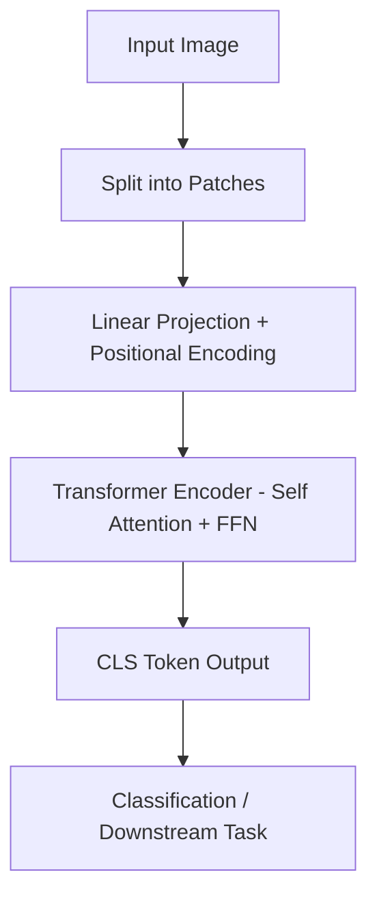
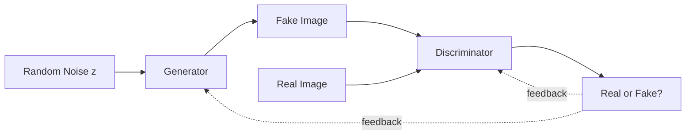

# UNIT II – Generative Models for Images & Diffusion

> **Syllabus coverage:** CNNs and Vision Transformers; Generative Adversarial Networks (GANs); Diffusion models (Denoising Score Matching, DDPM); Variational Autoencoders (VAEs); Applications (Text-to-image: DALL·E, inpainting, Stable Diffusion XL, SD Turbo); Video Generation Models (Sora, Runway Gen-3, Pika); Comparative Evaluation (FID, CLIP Score, human preference).

**Exam weightage in this unit:** 🟡 **Priority 2/3 (Moderate)** — appears less frequently across the supplied papers compared to Units I, III, and IV (only one of the four papers tests this unit in depth). Still, Part-A short questions from this unit are common, so cover the core definitions and comparisons thoroughly even if not chosen for deep descriptive preparation.

---

## 1. CNNs and Vision Transformers (ViTs)

### A. Definition
A **Convolutional Neural Network (CNN)** is a deep learning architecture that uses convolutional layers with learnable filters to automatically extract spatial hierarchical features (edges, textures, shapes) from image data.

A **Vision Transformer (ViT)** is an adaptation of the Transformer architecture to images, where an image is divided into fixed-size patches, each treated as a "token," and processed using self-attention instead of convolutions.

### B. Simple Explanation
A CNN looks at an image the way a person scans with a magnifying glass — small patches at a time, detecting edges and patterns, building up to complex shapes. A ViT instead cuts the image into a grid of small squares (patches), treats each square like a "word" in a sentence, and uses the same attention mechanism Transformers use for text to figure out which patches relate to each other.

### C. Detailed Explanation

**CNN – Working Principle:**
1. **Convolution Layer:** Slides small filters/kernels over the image to detect local features (edges, corners).
2. **Activation (ReLU):** Introduces non-linearity.
3. **Pooling Layer:** Downsamples feature maps (e.g., max pooling) to reduce dimensionality and add translation invariance.
4. **Fully Connected Layer:** Combines extracted features for final classification/task output.
5. Stacking multiple convolution+pooling layers builds a hierarchy: early layers detect edges, deeper layers detect complex shapes/objects.

**Vision Transformer (ViT) – Working Principle:**
1. **Patch Embedding:** The image is split into fixed-size patches (e.g., 16×16 pixels), each flattened and linearly projected into an embedding vector.
2. **Positional Encoding:** Added to retain spatial position information (since attention has no inherent sense of order).
3. **Transformer Encoder:** Standard multi-head self-attention + feed-forward layers process the sequence of patch embeddings.
4. **Classification Token (CLS):** A special learnable token is prepended, whose final representation is used for downstream classification tasks.

### D. Diagram

**CNN:**
```
Input Image -> [Conv Layer + ReLU] -> [Pooling] -> [Conv Layer + ReLU] -> [Pooling] -> [Fully Connected] -> Output
```

**ViT:**


### E. Comparison Table

| Feature | CNN | Vision Transformer (ViT) |
|---|---|---|
| Core operation | Convolution (local receptive field) | Self-attention (global receptive field) |
| Inductive bias | Strong (locality, translation invariance) | Weak (learns relationships from data) |
| Data requirement | Works well with smaller datasets | Needs large datasets to perform well |
| Long-range dependency | Limited (needs deep layers) | Captured directly via attention |
| Computational pattern | Hierarchical, local-to-global | Parallel, global from the start |

### F. Real-world Examples
- CNN: Image classification (ResNet), facial recognition, medical image diagnosis.
- ViT: Google's image classification systems, used as the backbone in CLIP and many modern multimodal/generative models.

### H. Important Keywords
Convolution, kernel/filter, pooling, receptive field, patch embedding, CLS token, self-attention, inductive bias.

---

## 2. Generative Adversarial Networks (GANs)

### A. Definition
A **Generative Adversarial Network (GAN)** is a generative model consisting of two neural networks — a **Generator** and a **Discriminator** — trained simultaneously in an adversarial (zero-sum game) process, where the Generator tries to produce realistic synthetic data and the Discriminator tries to distinguish real data from generated (fake) data.

### B. Simple Explanation
Think of a forger (Generator) trying to create fake paintings and an art expert (Discriminator) trying to detect fakes. Over time, as the expert gets better at catching fakes, the forger gets better at making convincing paintings — and vice versa — until the forger's fakes become nearly indistinguishable from real paintings.

### C. Detailed Explanation

**Architecture and Working:**
1. **Generator (G):** Takes random noise `z` (sampled from a latent distribution) as input and transforms it into synthetic data (e.g., an image) `G(z)`.
2. **Discriminator (D):** Takes either real data or generated data as input and outputs a probability that the input is real.
3. **Adversarial Training (minimax game):**
   - Discriminator is trained to maximize its ability to correctly classify real vs fake.
   - Generator is trained to minimize the Discriminator's ability to detect its fakes (i.e., fool the Discriminator).
   - Objective: `min_G max_D [E[log D(x)] + E[log(1 - D(G(z)))]]`
4. Training continues until, ideally, the Generator produces data indistinguishable from real data (Discriminator outputs ≈ 0.5, i.e., random guessing).

**Challenges:**
- **Mode collapse:** Generator produces limited variety of outputs.
- **Training instability:** Balancing G and D training is difficult; one can overpower the other.

### D. Diagram


### E. Comparison Table (GAN vs other generative models — expand in Diffusion section below)

| Aspect | GAN |
|---|---|
| Training approach | Adversarial (two competing networks) |
| Output quality | Sharp, high-fidelity images |
| Training stability | Often unstable (mode collapse risk) |
| Sampling speed | Fast (single forward pass) |
| Likelihood estimation | No explicit density estimation |

### F. Real-world Example
GANs have been used for deepfake generation, realistic face generation (e.g., "this person does not exist"), and image super-resolution.

### H. Important Keywords
Generator, Discriminator, adversarial training, minimax game, latent noise vector, mode collapse, Nash equilibrium.

---

## 3. Diffusion Models

### A. Definition
**Diffusion models** are generative models that learn to generate data by reversing a gradual noising process — they are trained to iteratively denoise a sample that starts as pure random noise, step by step, until it becomes a realistic data sample (e.g., image).

### B. Simple Explanation
Imagine slowly adding static/noise to a photo until it becomes pure random noise (the "forward process"). A diffusion model learns to **reverse** this — starting from pure noise, it gradually removes noise step by step until a clear, realistic image emerges (the "reverse process").

### C. Detailed Explanation

**Forward (Diffusion) Process:**
- Gradually adds Gaussian noise to a real data sample `x_0` over `T` timesteps, producing increasingly noisy versions `x_1, x_2, ..., x_T`, until `x_T` is approximately pure noise.
- This process is fixed (not learned) and follows a defined noise schedule.

**Reverse (Denoising) Process:**
- A neural network (typically a U-Net architecture) is trained to predict and remove the noise added at each step, gradually reconstructing `x_0` from `x_T`.
- The model learns to predict the noise component `ε` at each timestep, given the noisy sample and the timestep.

**Denoising Score Matching:**
- A technique where the model learns the **gradient of the log probability density (score function)** of the data distribution at various noise levels, which guides the denoising process toward high-probability (realistic) regions of data space.

**DDPM (Denoising Diffusion Probabilistic Models):**
- The foundational diffusion model framework formalizing the forward noising and reverse denoising processes as a Markov chain, using a neural network to predict noise at each step and a defined loss function based on the difference between actual and predicted noise.

**Applications:**
- **Text-to-Image Generation (e.g., DALL·E):** Conditions the diffusion/denoising process on text embeddings (often from a CLIP-like encoder) to generate images matching a text prompt.
- **Image Inpainting:** Using diffusion models to fill in missing or masked parts of an image realistically, conditioned on the surrounding context.
- **Stable Diffusion XL (2023) and SD Turbo (2024):** More efficient, higher-quality, and widely industry-adopted diffusion models. SD Turbo uses techniques like adversarial distillation to achieve high-quality generation in very few steps (even a single step), dramatically speeding up inference compared to earlier multi-step diffusion models.

### D. Diagram
```
Forward process (fixed, adds noise):
x0 (real image) --> x1 --> x2 --> ... --> xT (pure noise)

Reverse process (learned, removes noise):
xT (pure noise) --> ... --> x2 --> x1 --> x0 (generated image)
                 [U-Net predicts noise at each step]
```

### E. Comparison Table — GANs vs Diffusion Models vs VAEs

| Feature | GANs | Diffusion Models | VAEs |
|---|---|---|---|
| Training stability | Unstable (adversarial) | Stable | Stable |
| Sample quality | High fidelity, sharp | Very high fidelity, diverse | Often blurrier |
| Sampling speed | Fast (1 pass) | Slow (many denoising steps, though improving with distillation) | Fast (1 pass) |
| Mode coverage | Prone to mode collapse | Good diversity | Good diversity |
| Likelihood-based | No | Yes (approximate) | Yes (via ELBO) |
| Training objective | Adversarial minimax | Denoising/score matching | Reconstruction + KL divergence |

### F. Real-world Examples
- DALL·E, Stable Diffusion, Midjourney — text-to-image generation.
- SD Turbo — fast, near real-time image generation for industry applications.

### G. University Examination Answer — "Explain the Diffusion Model framework for image generation. Discuss forward/reverse diffusion and compare with GANs."
1. **Definition** of diffusion models.
2. **Forward process:** gradual noise addition (explain with diagram).
3. **Reverse process:** learned denoising using U-Net, trained via denoising score matching / DDPM framework.
4. **Key applications:** text-to-image (DALL·E), inpainting, SD XL/Turbo.
5. **Comparison with GANs:** stability, sample quality, speed (use comparison table).
6. **Conclusion:** Diffusion models offer more stable training and higher sample diversity than GANs, though traditionally slower at inference — a gap being closed by models like SD Turbo.

### H. Important Keywords
Forward diffusion, reverse diffusion, denoising, score matching, DDPM, U-Net, noise schedule, Markov chain, text-conditioning, latent diffusion.

---

## 4. Variational Autoencoders (VAEs)

### A. Definition
A **Variational Autoencoder (VAE)** is a generative model composed of an encoder that maps input data to a probabilistic latent space (as a distribution, typically Gaussian) and a decoder that reconstructs data samples from points in that latent space, trained to maximize a lower bound (ELBO) on the data likelihood.

### B. Simple Explanation
A VAE compresses an image into a compact "code" (like a summary), but instead of a single fixed code, it learns a range/distribution of possible codes — then a decoder can sample from this distribution and reconstruct new, similar images, enabling generation of novel but realistic samples.

### C. Detailed Explanation
- **Encoder:** Maps input `x` to parameters (mean `μ` and variance `σ²`) of a latent distribution `q(z|x)`, instead of a single fixed vector (as in a standard autoencoder).
- **Reparameterization Trick:** Allows backpropagation through the random sampling step by expressing `z = μ + σ·ε`, where `ε` is sampled from a standard normal distribution.
- **Decoder:** Reconstructs data `x'` from sampled latent vector `z`.
- **Loss Function:** Combination of **reconstruction loss** (how close `x'` is to `x`) and **KL divergence** (regularizes the latent distribution to be close to a standard normal prior), together forming the **Evidence Lower Bound (ELBO)**.

### D. Diagram
```
Input x --> [Encoder] --> μ, σ (latent distribution params)
                              |
                      z = μ + σ·ε (reparameterization)
                              |
                         [Decoder] --> Reconstructed x'
```

### F. Real-world Example
VAEs are used in anomaly detection, image denoising, and as components within more complex generative pipelines (e.g., latent diffusion models use a VAE to compress images into a latent space before diffusion).

### H. Important Keywords
Encoder, decoder, latent space, reparameterization trick, KL divergence, ELBO (Evidence Lower Bound), reconstruction loss.

---

## 5. Video Generation Models

### C. Detailed Explanation
- **Sora (OpenAI):** A text-to-video diffusion-based model capable of generating realistic, extended video clips from text prompts, modeling temporal consistency across frames.
- **Runway Gen-3:** A commercial video generation model enabling high-quality text-to-video and image-to-video generation, widely used in creative/media industries.
- **Pika:** A video generation platform allowing users to create and edit short video clips from text/image prompts.
- These models generally extend image diffusion techniques to the temporal dimension, needing to maintain consistency of objects, motion, and scene coherence across many frames.

### H. Important Keywords
Text-to-video, temporal consistency, frame coherence, video diffusion.

---

## 6. Comparative Evaluation of Generative Image/Video Models

### A. Definition
Comparative evaluation metrics quantitatively assess the quality, realism, and alignment of generated images with intended prompts or real-data distributions.

### C. Detailed Explanation
- **FID (Fréchet Inception Distance):** Measures the distance between the feature distributions of real images and generated images (using a pretrained Inception network), where **lower FID indicates generated images are statistically closer to real images** (higher quality/realism).
- **CLIP Score:** Measures the semantic alignment between a generated image and its text prompt, using CLIP's joint image-text embedding space — **higher CLIP score indicates better text-image alignment**.
- **Human Preference:** Subjective evaluation where human raters compare/rank generated outputs, often used as a ground-truth complement to automated metrics since automated scores don't always capture perceptual quality or aesthetic preference.

### E. Comparison Table

| Metric | What it Measures | Better Value |
|---|---|---|
| FID | Statistical similarity to real image distribution | Lower is better |
| CLIP Score | Text-image semantic alignment | Higher is better |
| Human Preference | Subjective quality/aesthetic judgment | N/A (ranking-based) |

### H. Important Keywords
FID, CLIP Score, Inception network, semantic alignment, human evaluation.

---

## Quick Revision Summary (Unit II)

| Topic | One-line Recall |
|---|---|
| CNN | Convolution + pooling; local feature extraction |
| ViT | Image as patches; self-attention based |
| GAN | Generator vs Discriminator adversarial game |
| Diffusion Model | Learn to reverse a noising process (denoising) |
| DDPM | Formal framework for diffusion as a Markov chain |
| VAE | Encoder-decoder with probabilistic latent space, ELBO loss |
| DALL·E / Stable Diffusion | Text-to-image diffusion models |
| SD Turbo | Fast, few-step diffusion via distillation |
| Sora / Runway Gen-3 / Pika | Text-to-video generation models |
| FID | Lower = more realistic (distribution distance) |
| CLIP Score | Higher = better text-image alignment |
