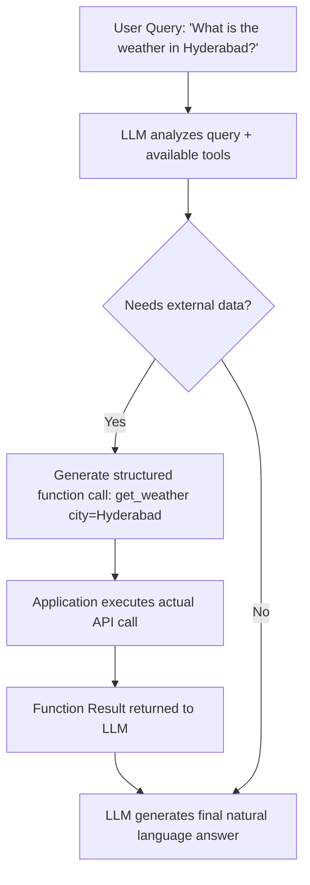

# UNIT III – Adaptation & Control of Generative Models

> **Syllabus coverage:** In-context learning; Prompt engineering and Prompt-to-Prompt; Fine-tuning (LoRA, Adapter tuning); Reinforcement Learning from Human Feedback (RLHF); Applications (instruction tuning, controlled generation); Direct Preference Optimization (DPO) and ORPO; Function Calling / Tool Use; How models use APIs, tools, and planners (e.g., function-calling in OpenAI GPT-4o).

**Exam weightage in this unit:** 🔴 **Priority 1 (Very Important)** — one of the most heavily and consistently tested units across the supplied papers (LoRA, prompt engineering, function calling, in-context learning, and RLHF/DPO/ORPO each appear in multiple papers). **Strongly recommended for detailed preparation.**

---

## 1. In-Context Learning

### A. Definition
**In-context learning (ICL)** is the ability of a large language model to learn to perform a new task by conditioning on a few examples (or instructions) provided directly within the input prompt, **without updating any of the model's internal parameters/weights**.

### B. Simple Explanation
Instead of retraining the model, you simply show it a few examples of what you want right inside your question/prompt, and the model figures out the pattern and applies it to your new input — similar to showing someone 2-3 solved examples before asking them to solve a new problem.

### C. Detailed Explanation
- **Zero-shot learning:** No examples given; only a task instruction (e.g., "Translate this sentence to French: ...").
- **One-shot learning:** One example provided before the actual query.
- **Few-shot learning:** Several examples provided to establish the pattern before the actual query.
- The model uses its attention mechanism to recognize the pattern from the given examples within the context window and applies similar reasoning to the new input — this is possible due to patterns learned implicitly during large-scale pre-training, not due to any gradient updates at inference time.
- **Key distinction:** ICL happens entirely at inference time; no weights are changed, unlike fine-tuning.

### D. Diagram
```
Prompt: 
"Translate English to French:
sea otter -> loutre de mer
cheese -> fromage
peppermint -> ?"

Model generates: "menthe poivrée" 
(Learned the pattern from the 2 examples in-context, without any weight updates)
```

### E. Comparison Table

| Aspect | In-Context Learning | Parameter-Efficient Fine-Tuning (e.g., LoRA) |
|---|---|---|
| Weight updates | None | Small number of new parameters trained |
| Cost | Very low (just prompt engineering) | Moderate (requires training, though lightweight) |
| Flexibility | Easy to change task on the fly | Requires retraining for new tasks |
| Performance on complex/niche tasks | Limited by context window and example quality | Generally better, more reliable |
| Persistence | Not retained after the session/prompt | Persisted in model/adapter weights |

### F. Real-world Example
Giving ChatGPT a few examples of a desired email tone/format in the prompt itself, so subsequent emails generated follow the same style — without any fine-tuning.

### G. University Examination Answer — "What is in-context learning? Give one example." / "Compare in-context learning with parameter-efficient fine-tuning in terms of cost, flexibility and performance"
1. **Definition** as above.
2. **Types:** zero-shot, one-shot, few-shot (briefly explain each).
3. **Example:** translation example as above.
4. **Comparison with PEFT (LoRA):** cost (ICL cheaper, no training needed), flexibility (ICL more flexible for quick task switching but limited by context length; PEFT more robust for persistent specialization), performance (PEFT generally yields better task-specific performance for complex/niche tasks since it adapts actual model behavior).
5. **Conclusion:** ICL is best for quick, flexible adaptation with no training cost, while PEFT methods like LoRA are better suited when consistent, specialized performance is needed repeatedly.

### H. Important Keywords
Zero-shot, one-shot, few-shot, context window, inference-time adaptation, no weight updates.

---

## 2. Prompt Engineering and Prompt-to-Prompt

### A. Definition
**Prompt engineering** is the practice of carefully designing and structuring input prompts to a language model to elicit the most accurate, relevant, or desired output, without modifying the model itself.

**Prompt-to-Prompt** is a technique (primarily in image diffusion models) that enables controlled editing of a generated image by modifying only the text prompt, while preserving the overall structure/composition of the original generated image by manipulating cross-attention maps.

### B. Simple Explanation
Prompt engineering is about asking the AI the "right way" to get the best answer — like learning how to phrase a question clearly to get a more useful response. Prompt-to-Prompt is a specific trick for image generation models, where changing just one word in a text prompt (e.g., "cat" → "dog") regenerates the image with that specific change while keeping everything else in the picture the same.

### C. Detailed Explanation

**Types of Prompt Engineering Techniques:**

1. **Zero-shot prompting:** Directly asking the model to perform a task without examples (e.g., "Summarize this paragraph.").
2. **Few-shot prompting:** Providing a handful of input-output examples within the prompt to guide the model's response format/style.
3. **Chain-of-Thought (CoT) prompting:** Instructing the model to reason step-by-step before arriving at a final answer (e.g., "Let's think step by step"), significantly improving performance on reasoning/math tasks.
4. **Role prompting / Persona prompting:** Assigning the model a specific role or persona (e.g., "You are an expert doctor...") to shape the tone and depth of the response.
5. **Instruction prompting:** Giving explicit, clear instructions about format, length, and constraints of the desired output.
6. **Self-consistency prompting:** Generating multiple reasoning paths/answers and selecting the most consistent/common one.

**Prompt-to-Prompt (for image diffusion models):**
- Works by manipulating the **cross-attention maps** between the text prompt tokens and image regions during the diffusion denoising process.
- When a word in the prompt is changed, only the cross-attention associated with that word is modified, allowing localized editing (e.g., changing the color of an object) while preserving the rest of the image's layout and structure.

### D. Diagram
```
Original Prompt: "A red car on the street"  --> [Diffusion Model] --> Image A

Edited Prompt: "A blue car on the street"  
       |
[Prompt-to-Prompt: swap cross-attention map for "red"->"blue" only]
       |
       v
Image A' (same car, street, composition — only color changed)
```

### E. Comparison Table

| Technique | Purpose | Example Use |
|---|---|---|
| Zero-shot prompting | Task without examples | Quick, simple tasks |
| Few-shot prompting | Pattern demonstration | Format-specific generation |
| Chain-of-Thought | Step-by-step reasoning | Math, logic problems |
| Role/Persona prompting | Tone/style control | Domain-specific responses |
| Prompt-to-Prompt | Controlled image editing | Modifying generated images |

### F. Real-world Example
Adding "Let's think step by step" to a math word problem prompt (Chain-of-Thought) significantly improves an LLM's accuracy on multi-step arithmetic reasoning.

### G. University Examination Answer — "Briefly explain two types of prompt engineering techniques" / "Explain prompt engineering, in-context learning, and prompt-tuning"
1. **Definition** of prompt engineering.
2. **Explain 2+ techniques in detail** (commonly: Chain-of-Thought and Few-shot prompting) with examples.
3. If asked about prompt-tuning too: **Prompt-tuning** is a parameter-efficient method where a small set of continuous "soft prompt" embeddings are learned and prepended to the input, while the rest of the model remains frozen — different from manual prompt engineering since the prompt vectors themselves are learned via gradient descent, not handwritten.
4. **How these improve performance:** better task alignment, reduced ambiguity, improved reasoning, reduced need for costly fine-tuning.
5. **Conclusion.**

### H. Important Keywords
Zero-shot, few-shot, Chain-of-Thought (CoT), role prompting, soft prompts, prompt-tuning, cross-attention manipulation, Prompt-to-Prompt.

---

## 3. Fine-Tuning: LoRA and Adapter Tuning

### A. Definition
**Fine-tuning** adapts a pre-trained model's weights using task-specific data. **Parameter-Efficient Fine-Tuning (PEFT)** methods like **LoRA** and **Adapter tuning** achieve this adaptation by training only a small number of additional parameters while keeping the original pre-trained weights frozen.

**LoRA (Low-Rank Adaptation):** A PEFT technique that injects small, trainable low-rank matrices into the layers of a pre-trained model (typically into attention weight matrices), approximating the weight update `ΔW` as a product of two much smaller matrices, drastically reducing the number of trainable parameters.

**Adapter tuning:** A PEFT technique that inserts small additional neural network modules ("adapters") between the layers of a pre-trained model, training only these adapter modules while freezing the original model weights.

### B. Simple Explanation
Full fine-tuning means retraining the entire giant model — expensive and slow. LoRA instead adds tiny "patch" matrices alongside the existing weights and only trains those tiny patches, achieving similar results at a fraction of the cost. Adapter tuning is similar in spirit — it inserts small extra layers into the network and only trains those, leaving the giant original network untouched.

### C. Detailed Explanation

**Full Fine-Tuning:**
- Updates **all** parameters of the pre-trained model.
- Requires significant GPU memory and compute (must store gradients/optimizer states for billions of parameters).
- Risk of **catastrophic forgetting** (losing general capabilities while specializing).
- Produces a full new copy of the model for each task.

**LoRA – Working Principle:**
- For a pre-trained weight matrix `W` (e.g., in attention layers), instead of updating `W` directly, LoRA freezes `W` and learns a low-rank decomposition `ΔW = B·A`, where `A` and `B` are much smaller matrices (rank `r` is small, e.g., 4-64).
- The effective weight during inference becomes `W + B·A`.
- Only `A` and `B` are trained — drastically fewer parameters than full fine-tuning (often <1% of original parameters).
- Multiple LoRA adapters can be trained for different tasks and swapped in/out of the same base model.

**Adapter Tuning – Working Principle:**
- Small bottleneck feed-forward modules (down-project → non-linearity → up-project) are inserted after specific layers (e.g., after attention or feed-forward sublayers) in the Transformer.
- Only these adapter modules' parameters are updated during training; the original Transformer weights remain frozen.

**Example (small, illustrative):**
Suppose a weight matrix `W` is of size 1000×1000 (1,000,000 parameters). Full fine-tuning updates all 1,000,000 parameters. With LoRA using rank `r=8`: matrices `A` (8×1000) and `B` (1000×8) together have only `8,000 + 8,000 = 16,000` trainable parameters — about **1.6%** of the full fine-tuning parameter count, while still effectively adapting the model's behavior.

### D. Diagram
```
Full Fine-tuning:
[Pretrained Weight W] --> all elements updated during training

LoRA:
[Pretrained Weight W - FROZEN] 
            +
[Low-rank matrices B (d x r) * A (r x d) - TRAINED]
            =
      Effective weight = W + B*A
```

### E. Comparison Table

| Aspect | Full Fine-Tuning | LoRA | Adapter Tuning |
|---|---|---|---|
| Parameters trained | All (100%) | Small fraction (<1-5%) | Small fraction (added modules) |
| Memory/compute cost | Very high | Low | Low |
| Risk of catastrophic forgetting | Higher | Lower | Lower |
| Storage per task | Full model copy | Small adapter file | Small adapter file |
| Inference overhead | None (same architecture) | Minimal (can be merged into W) | Slight (extra layers at inference) |

### F. Real-world Example
A company wants to fine-tune GPT for legal-document summarization without the cost of full fine-tuning — they use LoRA to train small adapter matrices on a legal dataset, drastically reducing GPU cost while achieving domain-specific performance.

### G. University Examination Answer — "Compare LoRA and full fine-tuning using a small example"
1. **Definition** of full fine-tuning and LoRA.
2. **Working mechanism** of LoRA (low-rank decomposition, frozen W + trainable B·A).
3. **Numerical example** as above (1000×1000 matrix, rank 8 → 16,000 vs 1,000,000 parameters).
4. **Comparison table** (memory, cost, forgetting risk, storage).
5. **Conclusion:** LoRA achieves comparable task performance to full fine-tuning at a fraction of the computational and storage cost, making it the preferred approach for adapting very large models.

### H. Important Keywords
Parameter-Efficient Fine-Tuning (PEFT), LoRA, low-rank decomposition, rank (r), frozen weights, adapter module, catastrophic forgetting, bottleneck layer.

---

## 4. Reinforcement Learning from Human Feedback (RLHF), DPO, and ORPO

### A. Definition
**RLHF (Reinforcement Learning from Human Feedback)** is a training technique that aligns a language model's outputs with human preferences by training a reward model on human-ranked comparisons of model outputs, then using reinforcement learning (typically PPO) to fine-tune the language model to maximize this learned reward.

**DPO (Direct Preference Optimization)** is a method that directly optimizes a language model on human preference data using a simple classification-style loss function, **without** requiring a separate reward model or reinforcement learning loop.

**ORPO (Odds Ratio Preference Optimization)** is a reference-model-free preference alignment method that combines supervised fine-tuning and preference alignment into a single training stage by adding an odds-ratio-based penalty term to the standard language modeling loss.

### B. Simple Explanation
RLHF is like training a model, then hiring human judges to rate which of its answers are better, training a separate "judge model" (reward model) from those ratings, and then using that judge to further coach the model via trial-and-error (reinforcement learning) — a complex, three-stage process. DPO simplifies this dramatically — it skips the separate judge model and reinforcement learning loop entirely, directly teaching the model "prefer this answer over that one" using a simpler, more stable training method. ORPO goes a step further by combining the "teach it to answer" step and the "teach it preferences" step into a single training pass.

### C. Detailed Explanation

**RLHF – Three-Stage Process:**
1. **Supervised Fine-Tuning (SFT):** Start with a pre-trained model, fine-tune it on high-quality human-written demonstrations.
2. **Reward Model Training:** Humans rank multiple model outputs for the same prompt (preference pairs); a separate reward model is trained to predict these human preference scores.
3. **RL Fine-tuning (typically PPO – Proximal Policy Optimization):** The language model (policy) is further fine-tuned using reinforcement learning to generate outputs that maximize the reward predicted by the reward model, with a KL-divergence penalty to prevent the model from straying too far from the original SFT model.

**Limitations of RLHF:** Complex pipeline (3 separate models/stages), computationally expensive, training instability due to RL, requires careful hyperparameter tuning.

**DPO – Working Principle:**
- Reformulates the RLHF objective mathematically such that the optimal policy can be derived directly from preference data using a simple binary cross-entropy-style loss, eliminating the need for a separate reward model and RL training loop.
- Directly increases the probability of the "preferred" response and decreases the probability of the "dispreferred" response relative to a reference model, using the preference pairs directly.
- Much simpler, more stable, and computationally cheaper than RLHF, while achieving comparable or better alignment performance.

**ORPO – Working Principle:**
- Unlike DPO, which still requires a separately trained SFT reference model to compute its loss, **ORPO requires no reference model at all**.
- Combines the standard supervised fine-tuning **cross-entropy loss** with an **odds-ratio-based penalty** that discourages the model from generating dispreferred (rejected) responses, all within a single training stage.
- This makes ORPO more efficient (single-stage, no reference model needed) while still achieving strong preference alignment.

### D. Diagram
```
RLHF Pipeline:
Pretrained Model --> [SFT: fine-tune on demonstrations] --> SFT Model
                                                                |
Human Preference Rankings --> [Train Reward Model] --> Reward Model
                                                                |
SFT Model + Reward Model --> [RL (PPO) fine-tuning] --> Aligned Model

DPO Pipeline (simplified, no reward model/RL):
Pretrained/SFT Model + Preference Pairs --> [Direct Preference Loss] --> Aligned Model

ORPO Pipeline (single stage, no reference model):
Pretrained Model + Preference Pairs --> [SFT Loss + Odds-Ratio Penalty, jointly] --> Aligned Model
```

### E. Comparison Table

| Aspect | RLHF | DPO | ORPO |
|---|---|---|---|
| Separate reward model | Yes | No | No |
| Reinforcement learning needed | Yes (PPO) | No | No |
| Reference model needed | N/A (uses reward model + KL to SFT model) | Yes (frozen reference model) | No |
| Number of training stages | 3 (SFT, reward model, RL) | 2 (SFT, then DPO) | 1 (combined) |
| Training stability | Lower (RL is sensitive) | Higher | Higher |
| Computational cost | High | Moderate | Low |

### F. Real-world Example
ChatGPT was aligned using RLHF to make its responses helpful, honest, and harmless according to human preferences. Many newer open-source models (e.g., some Zephyr/Mistral-derivative models) use DPO or ORPO for more efficient alignment with comparable results.

### G. University Examination Answer — "What is DPO and how does it differ from traditional RLHF?" / "Analyze the differences between RLHF, DPO, and ORPO for aligning models with human preference"
1. **Definitions** of all three (RLHF, DPO, ORPO).
2. **RLHF pipeline explanation** (SFT → reward model → PPO) with diagram.
3. **DPO explanation:** direct optimization, no reward model/RL, simpler loss.
4. **ORPO explanation:** single-stage, no reference model, odds-ratio penalty.
5. **Comparison table** (stages, reward model, RL requirement, stability, cost).
6. **Conclusion:** The evolution from RLHF → DPO → ORPO reflects a trend toward simpler, more stable, and more computationally efficient methods for aligning LLMs with human preferences, while maintaining alignment quality.

### H. Important Keywords
RLHF, reward model, PPO (Proximal Policy Optimization), KL-divergence penalty, DPO, preference pairs, reference model, ORPO, odds ratio, alignment, instruction tuning.

---

## 5. Function Calling / Tool Use and AI Agents

### A. Definition
**Function Calling** is a capability where a language model, given a set of available function/tool definitions (name, description, parameters), can decide which function to call and generate the appropriately structured arguments (typically JSON) needed to invoke that function to fulfill a user's request, based on the conversation context.

### B. Simple Explanation
Normally an LLM can only generate text. Function calling lets it say, in effect, "I need to call the `get_weather(city)` function with city='Hyderabad' to answer this," producing a structured request that an external system executes — the LLM becomes able to interact with real-world systems/APIs rather than just generating text.

### C. Detailed Explanation — How Function Calling Works

1. **Function/Tool Definition:** The developer provides the model with a schema describing available functions — their names, descriptions, and expected parameters (e.g., a JSON schema).
2. **User Query:** The model receives a natural language query from the user.
3. **Model Decision:** Based on the query and available function definitions, the model determines (a) whether a function call is needed, and (b) which function and what arguments are appropriate.
4. **Structured Output Generation:** The model outputs a structured call (e.g., `{"function": "get_weather", "arguments": {"city": "Hyderabad"}}`) instead of (or alongside) natural language text.
5. **Execution:** The actual function/API call is executed **outside** the model (by the application/orchestration layer), and the result (observation) is returned.
6. **Response Generation:** The model receives the function's result and uses it to generate a final natural-language response to the user.

**How models use APIs, tools, and planners (e.g., GPT-4o):**
- Modern LLMs like GPT-4o are trained/fine-tuned specifically to recognize when a query requires external information or action (e.g., real-time data, calculations, database queries) that the model cannot answer from its own parameters alone.
- A **planner** component (sometimes the LLM itself, sometimes a separate orchestration layer) may break a complex task into multiple sequential function calls, chaining tool outputs together (similar to the ReAct loop in Unit I).
- This enables applications like customer support (querying order databases), document automation (populating templates with retrieved data), and real-time information retrieval (fetching live data the model wasn't trained on).

### D. Diagram


### E. Comparison Table

| Aspect | Traditional LLM Response | Function Calling |
|---|---|---|
| Output type | Free-form text only | Structured function call (JSON) + text |
| Access to real-time/external data | No | Yes, via executed tool calls |
| Action capability | None | Can trigger real-world actions (bookings, queries, calculations) |
| Reliability for precise tasks | Lower (may hallucinate values) | Higher (delegates precision tasks to actual code/APIs) |

### F. Real-world Example
A customer support chatbot using GPT-4o's function calling can call a `check_order_status(order_id)` function against a company's real database and return the actual, accurate order status instead of guessing or hallucinating an answer.

### G. University Examination Answer — "Illustrate how function calling enables LLMs to use external tools or APIs" / "Explain Function Calling and AI Agents"
1. **Definition** of function calling.
2. **Step-by-step working** (as above, with diagram): function definitions provided → model decides → generates structured call → external execution → result fed back → final response.
3. **Why it matters:** overcomes LLM limitations (no real-time data, no ability to perform precise calculations or real-world actions, risk of hallucination for factual/numeric queries).
4. **Example:** weather/order-status example above.
5. **Applications:** customer support, document automation, information retrieval (tie back to Unit I industry use cases).
6. **Conclusion:** Function calling transforms LLMs from passive text generators into active agents capable of interacting with real-world systems reliably.

### H. Important Keywords
Function calling, tool use, JSON schema, structured output, API integration, planner, orchestration layer, GPT-4o, agentic behavior.

---

## Quick Revision Summary (Unit III)

| Topic | One-line Recall |
|---|---|
| In-context learning | Learn from examples in the prompt; no weight updates |
| Prompt engineering | Crafting prompts (zero-shot, few-shot, CoT, role) for better output |
| Prompt-to-Prompt | Edit generated images via cross-attention map manipulation |
| LoRA | Freeze W, train small low-rank matrices B·A |
| Adapter tuning | Insert small trainable bottleneck modules between frozen layers |
| RLHF | SFT → Reward Model → PPO reinforcement learning (3 stages) |
| DPO | Direct preference loss; no reward model, no RL |
| ORPO | Single-stage; no reference model; odds-ratio penalty |
| Function Calling | LLM generates structured calls to external tools/APIs |
