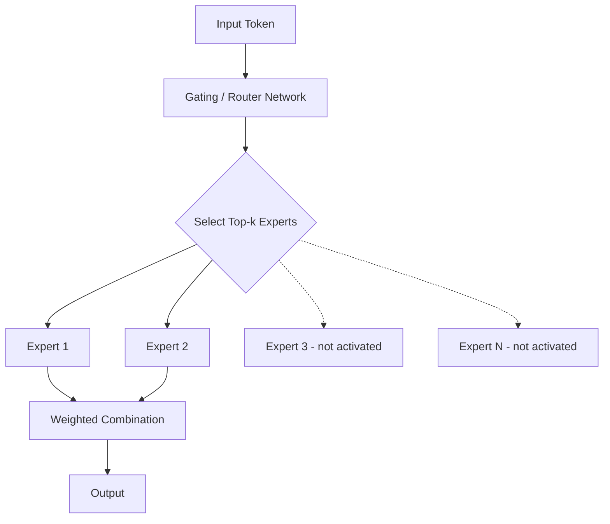
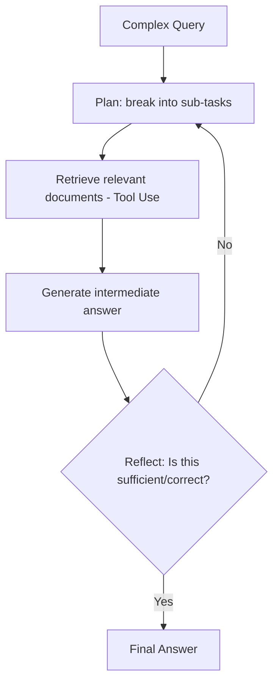

# UNIT IV – Scaling Laws & Efficient Training

> **Syllabus coverage:** Scaling laws in deep learning; Mixture-of-Experts (MoE); Efficient attention: FlashAttention, Longformer; Parallel and distributed training; Applications (efficient deployment of large models); Agentic RAG (planning, reflection, tool use in retrieval-augmented systems); Speculative Decoding; Token Merging; Quantization; Mamba, RWKV — efficient attention-free architectures.

**Exam weightage in this unit:** 🔴 **Priority 1 (Very Important)** — consistently and heavily tested across multiple papers (scaling laws, MoE, FlashAttention, quantization each appear in at least two separate papers, including the current Mid-2). **Strongly recommended for detailed preparation.**

---

## 1. Scaling Laws in Deep Learning

### A. Definition
**Scaling laws** describe empirically observed, predictable mathematical relationships (typically power-law relationships) between a model's performance (measured as loss) and key factors such as model size (number of parameters `N`), dataset size (number of training tokens `D`), and the amount of compute used for training `C`.

### B. Simple Explanation
Scaling laws tell us: if you make the model bigger, give it more data, and use more compute, its performance improves in a fairly predictable pattern (not randomly) — like a formula that tells you roughly how much better a model gets if you double its size or double its training data.

### C. Detailed Explanation

**Power-Law Relationship:**
- Test loss `L` decreases as a power-law function of model size `N`, dataset size `D`, or compute `C`: approximately `L(N) ∝ N^(-α)` for some small positive exponent `α` (and similarly for `D` and `C`).
- This means performance improvements have **diminishing returns** — doubling the model size does not halve the loss, but yields a predictable, smaller improvement following the power-law curve.

**Key Findings (Kaplan et al. / Chinchilla scaling laws):**
- Performance depends smoothly and predictably on `N`, `D`, and `C`, as long as none of them is a severe bottleneck.
- There exists an optimal balance between model size and dataset size for a given compute budget — the **Chinchilla scaling law** showed that many earlier large models (e.g., GPT-3) were "undertrained" relative to their size — i.e., for optimal performance per unit of compute, both model size and training data size should be scaled together (roughly proportionally), not just model size alone.
- This enables researchers to **extrapolate** expected performance of much larger models based on smaller-scale experiments, guiding efficient resource allocation before committing to expensive full-scale training runs.

**Practical Significance:**
- Helps organizations decide the optimal trade-off between spending compute budget on a bigger model vs. more training data.
- Enables predicting the performance of very large, expensive-to-train models from smaller, cheaper experiments.

### D. Diagram
```
Loss (L)
  |
  |\
  | \
  |  \___
  |      \______
  |             \__________
  |________________________\___________________ Model Size (N) / Data (D) / Compute (C)
  
  (Power-law decrease: large initial gains, then diminishing returns as N, D, C increase)
```

### E. Comparison Table

| Scaling Factor | Symbol | Effect on Loss |
|---|---|---|
| Model size (parameters) | N | Loss decreases as power-law of N |
| Dataset size (tokens) | D | Loss decreases as power-law of D |
| Compute budget | C | Loss decreases as power-law of C |

### F. Real-world Example
The Chinchilla paper showed that a smaller model (Chinchilla, 70B parameters) trained on more data outperformed a much larger model (Gopher, 280B parameters) trained on less data, for the same compute budget — demonstrating the importance of balancing model size and data size according to scaling laws.

### G. University Examination Answer — "Explain the concept of Scaling Laws in Deep Learning" / "Recall scaling power laws for Large Models learning"
1. **Definition** as above.
2. **Power-law relationship** with formula and diagram.
3. **Key insight:** diminishing returns; balance between N, D, C (mention Chinchilla finding).
4. **Practical significance:** guides efficient resource allocation for training large models.
5. **Conclusion:** Scaling laws provide a predictive, empirical framework for understanding how to efficiently scale deep learning models for better performance.

### H. Important Keywords
Power-law, model size (N), dataset size (D), compute (C), diminishing returns, Chinchilla scaling law, compute-optimal training.

---

## 2. Mixture-of-Experts (MoE)

### A. Definition
**Mixture-of-Experts (MoE)** is a neural network architecture where, instead of a single dense feed-forward network processing every input, multiple specialized sub-networks ("experts") exist, and a **gating/routing network** dynamically selects a small subset of experts to process each input token, activating only a fraction of the total model parameters per input.

### B. Simple Explanation
Instead of one giant brain processing everything, imagine a team of specialists (experts), each good at different things. For every question, a "router" decides which 1-2 specialists should handle it, rather than consulting the entire team every time — this way, the model can have a huge total number of parameters (knowledge) but only use a small, efficient portion of them for any given input.

### C. Detailed Explanation

**Architecture Components:**
1. **Experts:** Multiple independent feed-forward network (FFN) sub-modules, each potentially specializing in different types of patterns.
2. **Gating/Router Network:** A small trainable network that, for each input token, computes scores for all experts and selects the **top-k** experts (commonly top-1 or top-2) to process that token.
3. **Sparse Activation:** Only the selected top-k experts' parameters are actually used (activated) for a given token — the rest remain unused for that specific computation, drastically reducing the effective compute per token compared to a dense model of the same total parameter count.
4. **Combining Outputs:** The outputs of the selected experts are combined (often weighted by the gating scores) to produce the final output for that token.

**Advantages:**
- Enables massive increases in total model parameters (and thus model capacity/knowledge) without a proportional increase in computational cost per inference, since only a subset of experts is active at a time.
- Different experts can specialize in different types of linguistic patterns, domains, or tasks.

**Challenges:**
- **Load balancing:** Ensuring experts are used roughly equally (avoiding some experts being overused while others are rarely used) requires auxiliary loss terms during training.
- **Training complexity and instability** compared to dense models.
- **Communication overhead** in distributed settings, since routing tokens to experts may require inter-device communication.

### D. Diagram


### E. Comparison Table — Dense Transformer vs MoE Transformer

| Aspect | Dense Transformer | MoE Transformer |
|---|---|---|
| Parameters activated per token | All parameters | Only top-k experts' parameters |
| Total model capacity | Limited by compute cost | Can be much larger (total params) for similar compute |
| Compute cost per token | Fixed, proportional to total size | Lower, proportional to activated experts only |
| Training stability | More stable | Can be less stable (needs load balancing) |
| Inference complexity | Simple | More complex (routing overhead) |
| Example models | GPT-3 (dense) | Mixtral, GPT-4 (reported to use MoE) |

### F. Real-world Example
Mixtral 8x7B uses an MoE architecture with 8 experts per layer, activating only 2 experts per token, achieving performance comparable to much larger dense models while using significantly less compute per inference.

### G. University Examination Answer — "What is Mixture-of-Experts (MoE) Architecture?" / "Analyze the trade-offs between dense transformers and MoE transformers in terms of compute, training stability, cost and inference"
1. **Definition** as above.
2. **Architecture components:** experts, gating/router, sparse activation (with diagram).
3. **Advantages:** larger capacity without proportional compute increase.
4. **Trade-offs/Challenges:** load balancing, training instability, routing/communication overhead.
5. **Comparison table** (dense vs MoE: compute, stability, cost, inference).
6. **Conclusion:** MoE architectures provide an efficient way to scale model capacity while controlling inference compute cost, at the expense of added training and system complexity.

### H. Important Keywords
Experts, gating network, router, top-k routing, sparse activation, load balancing, Mixtral, auxiliary loss.

---

## 3. Efficient Attention: FlashAttention and Longformer

### A. Definition
**FlashAttention** is an IO-aware, exact attention algorithm that computes standard self-attention more efficiently by minimizing the number of reads/writes between GPU high-bandwidth memory (HBM) and on-chip SRAM, using tiling and recomputation techniques, without approximating the attention computation.

**Longformer** is a Transformer variant that replaces the standard full (quadratic-cost) self-attention with a combination of **sliding-window (local) attention** and selective **global attention**, reducing the computational complexity from quadratic to linear with respect to sequence length.

### B. Simple Explanation
Standard attention requires comparing every token to every other token — this becomes very slow and memory-hungry for long sequences (cost grows quadratically). FlashAttention doesn't change *what* is computed, but changes *how* it's computed on the GPU hardware (reducing unnecessary memory movement) to make it much faster and more memory-efficient, while producing the exact same result. Longformer instead changes *what* is computed — each token only attends to a small nearby "window" of tokens (plus a few selected "global" tokens), avoiding the need to compare every pair of tokens.

### C. Detailed Explanation

**FlashAttention – Architecture and How It Reduces Memory Overhead:**
- Standard attention implementations compute the full `N×N` attention score matrix (where `N` is sequence length) and store it in GPU HBM (slower, larger memory), requiring `O(N²)` memory and many slow read/write operations between HBM and SRAM (fast, small on-chip memory).
- FlashAttention uses **tiling**: it splits the Q, K, V matrices into smaller blocks that fit into fast SRAM, computes partial attention outputs block-by-block, and incrementally combines them using a numerically stable running softmax — **without ever materializing the full N×N attention matrix in HBM**.
- Uses **recomputation** during the backward pass (recomputing attention values on-the-fly from stored, smaller intermediate values) instead of storing the large attention matrix, trading a small amount of extra compute for a large reduction in memory usage and memory-access time.
- Result: Same exact mathematical output as standard attention, but significantly faster and more memory-efficient, especially for long sequences — enabling training/inference with much longer context windows.

**Longformer – Architecture:**
- **Sliding Window Attention:** Each token attends only to a fixed-size window of nearby tokens (local context), reducing complexity to `O(N × w)` where `w` is the window size, instead of `O(N²)`.
- **Global Attention:** A small number of pre-selected important tokens (e.g., the [CLS] token, or task-specific tokens) are allowed to attend to (and be attended to by) *all* tokens in the sequence, preserving the ability to capture some long-range/global information.
- **Dilated Sliding Window (optional):** Increases the effective receptive field without increasing computation, by skipping tokens at regular intervals within the window.

### D. Diagram

**FlashAttention (conceptual):**
```
Standard Attention: compute full NxN matrix in slow HBM memory -> O(N^2) memory, many HBM read/writes

FlashAttention: 
  Split Q,K,V into small blocks --> load blocks into fast SRAM 
  --> compute partial attention per block --> combine incrementally (running softmax)
  --> never store full NxN matrix in HBM
  Result: same output, far less memory movement, faster
```

**Longformer:**
```
Token:      1  2  3  4  5  6  7  8  9  10
Local window (w=2) for token 5: attends to tokens 3,4,5,6,7
Global token (e.g., token 1 = CLS): attends to ALL tokens; ALL tokens attend to it
```

### E. Comparison Table

| Aspect | Standard Attention | FlashAttention | Longformer |
|---|---|---|---|
| What changes | — (baseline) | How computation is executed (hardware-aware) | What is computed (sparse attention pattern) |
| Output | Exact | Exact (identical to standard) | Approximate (sparse, not full attention) |
| Complexity | O(N²) time & memory | O(N²) time, O(N) memory (reduced HBM access) | O(N) time & memory |
| Best for | Short-medium sequences | Any sequence length, especially long | Very long documents |

### F. Real-world Example
FlashAttention is used internally in many modern LLM training frameworks (e.g., PyTorch's scaled_dot_product_attention backend) to train models faster on long contexts. Longformer is used for tasks requiring processing of long documents, such as legal document analysis or long-form question answering.

### G. University Examination Answer — "Describe the architecture of FlashAttention and how it reduces memory overhead" / "Explain Flash Attention and Speculative Decoding"
1. **Definition** of FlashAttention.
2. **Problem it solves:** standard attention's HBM memory bottleneck due to materializing full N×N attention matrix.
3. **Mechanism:** tiling (block-wise computation in SRAM) + recomputation during backward pass + running softmax (with diagram).
4. **Result:** exact same output as standard attention, but much faster and memory-efficient, especially for long sequences.
5. Optionally mention **Longformer** as a contrasting *sparse* approach (changes what's computed, not just how).
6. **Conclusion:** FlashAttention exemplifies hardware-aware algorithm design that enables training and inference with significantly longer context windows without approximating the attention mechanism.

### H. Important Keywords
HBM (High Bandwidth Memory), SRAM, tiling, recomputation, running softmax, IO-aware, sliding window attention, global attention, Longformer, quadratic complexity.

---

## 4. Parallel and Distributed Training

### A. Definition
**Distributed training** refers to techniques for training very large neural networks across multiple GPUs/machines simultaneously, by splitting either the data, the model, or both, to overcome the memory and compute limitations of a single device.

### C. Detailed Explanation — Types of Distributed Training

1. **Data Parallelism:**
   - The full model is replicated across multiple GPUs; each GPU processes a different mini-batch (shard) of data in parallel.
   - Gradients computed on each GPU are averaged/synchronized (e.g., via all-reduce) before updating the model weights.
   - Simple to implement but requires the full model to fit in each GPU's memory.

2. **Model Parallelism:**
   - The model itself is split across multiple GPUs (e.g., different layers or different parts of layers reside on different devices), used when a model is too large to fit on a single GPU.
   - Requires careful coordination of data flow between GPUs holding different parts of the model.

3. **Pipeline Parallelism:**
   - The model is split into sequential stages (groups of layers) distributed across GPUs; different micro-batches of data flow through the pipeline stages concurrently (like an assembly line), improving GPU utilization compared to naive model parallelism.

4. **Tensor Parallelism:**
   - Individual large tensors/matrices (e.g., within a single layer's weight matrix) are split across multiple GPUs, with each GPU computing a portion of the operation and results combined via communication.

5. **ZeRO (Zero Redundancy Optimizer) / Fully Sharded Data Parallelism (FSDP):**
   - Shards optimizer states, gradients, and even model parameters across data-parallel GPUs (rather than fully replicating them), significantly reducing per-GPU memory requirements while retaining data-parallel-like training.

### D. Diagram
```
Data Parallelism:
GPU1: [Full Model] <- Batch 1        GPU2: [Full Model] <- Batch 2
         |                                    |
         +------------ gradients averaged (all-reduce) ------------+

Model/Pipeline Parallelism:
GPU1: [Layers 1-4] -> GPU2: [Layers 5-8] -> GPU3: [Layers 9-12]
(Different micro-batches flow through stages concurrently in pipeline parallelism)
```

### E. Comparison Table

| Technique | What is split | Best used when |
|---|---|---|
| Data Parallelism | Data batches (model replicated) | Model fits on one GPU, large dataset |
| Model Parallelism | Model layers/parameters | Model too large for one GPU |
| Pipeline Parallelism | Sequential model stages | Very deep models, improve GPU utilization |
| Tensor Parallelism | Individual large matrix operations | Extremely large individual layers |
| ZeRO / FSDP | Optimizer states, gradients, parameters | Memory-constrained large-scale training |

### G. University Examination Answer — "Briefly explain various Distributed training techniques used for large models"
1. **Why needed:** large models/datasets exceed single-GPU memory/compute capacity.
2. **Explain each technique** (data, model, pipeline, tensor parallelism, ZeRO/FSDP) briefly with what is split and when used.
3. **Diagram** for data and pipeline parallelism.
4. **Comparison table.**
5. **Conclusion:** Combining these techniques (often simultaneously, e.g., 3D parallelism) enables training of today's largest language models across thousands of GPUs.

### H. Important Keywords
Data parallelism, model parallelism, pipeline parallelism, tensor parallelism, all-reduce, ZeRO, FSDP, micro-batch, gradient synchronization.

---

## 5. Techniques to Improve Inference Efficiency

### A/C. Definitions and Detailed Explanation

**Speculative Decoding:**
- A technique to speed up autoregressive generation by using a small, fast "draft" model to quickly generate several candidate tokens ahead, which the larger, more accurate "target" model then verifies **in parallel** (in a single forward pass) — accepting correct tokens and discarding/correcting any mismatches.
- Since verifying multiple tokens in parallel is faster than generating them one-by-one autoregressively, this significantly speeds up inference **without changing the final output distribution** (the target model's quality is preserved).

**Token Merging:**
- A technique (especially used in Vision Transformers but also applicable elsewhere) that identifies and merges similar/redundant tokens during the forward pass, reducing the effective sequence length processed by subsequent layers, thereby reducing computation without significant loss in output quality.

**Quantization:**
- The process of reducing the numerical precision used to represent a model's weights and/or activations (e.g., converting 32-bit floating point (FP32) weights to 16-bit (FP16), 8-bit integer (INT8), or even 4-bit representations), reducing memory footprint and often increasing inference speed, usually with a small, controlled trade-off in accuracy.
- **Example (parameter-count/memory impact):** A model with 1 billion parameters stored in FP32 (4 bytes/parameter) requires `1,000,000,000 × 4 bytes = 4 GB` of memory. Quantizing to INT8 (1 byte/parameter) reduces this to `1,000,000,000 × 1 byte = 1 GB` — a **4x reduction in memory usage**, enabling deployment on smaller/cheaper hardware.

### D. Diagram
```
Speculative Decoding:
Draft Model (fast, small): generates tokens [t1, t2, t3] quickly
Target Model (large, accurate): verifies [t1, t2, t3] in ONE parallel forward pass
  -> if all correct: accept all 3 tokens in the time of ~1 target-model step
  -> if mismatch at t2: accept t1, discard t2/t3, regenerate from t2

Quantization:
FP32 weight (4 bytes) --> INT8 weight (1 byte)   [4x memory reduction example above]
```

### E. Comparison Table

| Technique | Mechanism | Primary Benefit |
|---|---|---|
| Speculative Decoding | Small draft model proposes, large model verifies in parallel | Faster generation, same output quality |
| Token Merging | Merge similar/redundant tokens | Reduced sequence length, less compute |
| Quantization | Lower numerical precision for weights/activations | Reduced memory footprint, faster inference |

### G. University Examination Answer — "Briefly explain various techniques used to improve inference efficiency" / "Demonstrate how quantization reduces memory usage with a simple parameter-count example" / "Explain the role of Quantization and Token Merging in reducing computational cost and improving inference speed"
1. **Definition** of each relevant technique asked.
2. **Mechanism explanation** with diagram.
3. **Numerical example for quantization** (as above: 1B params, FP32→INT8, 4GB→1GB, 4x reduction).
4. **Benefits:** faster inference, lower memory/hardware requirements, enabling deployment on edge devices or at lower cost.
5. **Conclusion:** These techniques collectively make large-model deployment practical and cost-effective in real-world industry settings.

### H. Important Keywords
Draft model, target model, speculative decoding, token merging, quantization, FP32, FP16, INT8, memory footprint, inference latency.

---

## 6. Mamba and RWKV — Efficient Attention-Free Architectures

### A. Definition
**Mamba** is a sequence modeling architecture based on **Selective State Space Models (SSMs)** that achieves linear-time sequence processing (instead of the Transformer's quadratic complexity) while incorporating a selection mechanism that allows the model to dynamically focus on relevant information, without using an attention mechanism at all.

**RWKV (Receptance Weighted Key Value)** is a hybrid architecture that combines the parallelizable training of Transformers with the efficient, constant-memory, linear-time sequential inference of RNNs, using a linear attention-like mechanism without the standard quadratic self-attention.

### B. Simple Explanation
Transformers are powerful but their attention mechanism gets expensive as sequences get longer (cost grows quadratically). Mamba and RWKV are alternative architectures designed to process sequences in **linear time** instead — more like an efficient, smarter RNN — allowing them to handle very long sequences (e.g., long documents, DNA sequences) much more efficiently than standard Transformers, while still achieving competitive performance.

### C. Detailed Explanation

**Mamba:**
- Built on **State Space Models (SSMs)**, which model sequences using a hidden state that evolves over time via linear recurrence equations (similar in spirit to classical control theory state-space models).
- The key innovation is **selectivity**: unlike earlier SSMs with fixed, input-independent parameters, Mamba's SSM parameters are made **input-dependent** (a function of the current input token), allowing the model to selectively "remember" or "forget" information based on content — closing the performance gap with attention-based models while retaining linear-time complexity.
- Achieves fast inference (constant memory per step, like an RNN) and efficient training (can be computed via parallel scan algorithms).

**RWKV:**
- Combines ideas from RNNs and Transformers: during **training**, it can be parallelized like a Transformer (processing all tokens in parallel using a linear-attention-like formulation); during **inference**, it behaves like an RNN, maintaining a fixed-size hidden state and processing tokens one at a time with constant memory and compute per token (regardless of sequence length).
- Avoids the quadratic cost and the need to cache ever-growing Key-Value pairs (as Transformers do), making it highly memory-efficient for very long sequences.

### D. Diagram
```
Transformer:  attention cost grows O(N^2) with sequence length N; KV cache grows with N

Mamba (SSM):  hidden state evolves linearly, input-dependent (selective) parameters
              h(t) = A(x_t)*h(t-1) + B(x_t)*x_t   [simplified concept]
              cost: O(N) - linear in sequence length

RWKV:         Training: parallelizable (like Transformer)
              Inference: RNN-like, constant memory per step, O(N) total
```

### E. Comparison Table

| Aspect | Transformer | Mamba | RWKV |
|---|---|---|---|
| Core mechanism | Self-attention | Selective State Space Model | Linear-attention / RNN hybrid |
| Time complexity | O(N²) | O(N) | O(N) |
| Inference memory | Grows with sequence (KV cache) | Constant (state-based) | Constant (RNN-like state) |
| Parallel training | Yes | Yes (parallel scan) | Yes |
| Long-sequence efficiency | Poor (quadratic cost) | Excellent | Excellent |

### F. Real-world Example
Mamba-based models have shown strong performance on long-sequence tasks like genomics (DNA sequence modeling) and long-document language modeling, where Transformer's quadratic cost becomes prohibitive.

### G. University Examination Answer — "Describe the Mamba and RWKV architectures. How do they provide efficient alternatives to traditional Transformer architectures?"
1. **Definitions** of both.
2. **Motivation:** Transformer's O(N²) attention cost and growing KV cache are bottlenecks for long sequences.
3. **Mamba explanation:** selective state space models, input-dependent parameters, linear-time complexity (with diagram/formula).
4. **RWKV explanation:** parallelizable training (Transformer-like) + RNN-like constant-memory inference.
5. **Comparison table** (Transformer vs Mamba vs RWKV).
6. **Conclusion:** Mamba and RWKV represent a new generation of attention-free architectures that achieve linear-time complexity, making them promising efficient alternatives to Transformers for long-sequence generative AI tasks.

### H. Important Keywords
State Space Model (SSM), selective mechanism, linear-time complexity, parallel scan, RWKV, KV cache, constant memory inference, attention-free architecture.

---

## 7. Agentic RAG (Retrieval-Augmented Generation)

### A. Definition
**Agentic RAG** extends standard Retrieval-Augmented Generation by incorporating agent-like capabilities — **planning**, **reflection**, and **tool use** — enabling the system to iteratively decide what information to retrieve, evaluate the quality/relevance of retrieved information, and refine its approach dynamically, rather than performing a single fixed retrieve-then-generate step.

### C. Detailed Explanation
- **Standard RAG:** Query → retrieve relevant documents from a knowledge base → generate answer conditioned on retrieved documents (single-pass).
- **Planning:** The agent decomposes a complex query into sub-queries or steps, deciding what needs to be retrieved and in what order.
- **Reflection:** The agent evaluates its own retrieved information or generated answer, identifying gaps or errors, and can decide to retrieve additional/different information if the current result seems insufficient.
- **Tool use:** The agent can use multiple tools (search, calculators, APIs, multiple retrievers) as part of its reasoning process, similar to the LLM agent/ReAct concepts from Unit I.

### D. Diagram


### H. Important Keywords
Retrieval-Augmented Generation (RAG), planning, reflection, tool use, iterative retrieval, knowledge base.

---

## Quick Revision Summary (Unit IV)

| Topic | One-line Recall |
|---|---|
| Scaling laws | Power-law relation between loss and model size/data/compute |
| Chinchilla | Balance model size & data for compute-optimal training |
| MoE | Router selects top-k experts; sparse activation |
| FlashAttention | Tiling + recomputation; reduces HBM read/writes; exact output |
| Longformer | Sliding window + global attention; linear complexity |
| Data/Model/Pipeline/Tensor Parallelism | Different ways to split training across GPUs |
| ZeRO/FSDP | Shard optimizer states/gradients/params across GPUs |
| Speculative Decoding | Small draft model proposes, large model verifies in parallel |
| Token Merging | Merge redundant tokens to reduce compute |
| Quantization | Lower precision (FP32→INT8) to cut memory/speed up inference |
| Mamba | Selective State Space Model; linear-time, attention-free |
| RWKV | Parallel training (Transformer-like) + RNN-like inference |
| Agentic RAG | RAG + planning + reflection + tool use |
