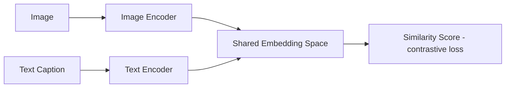
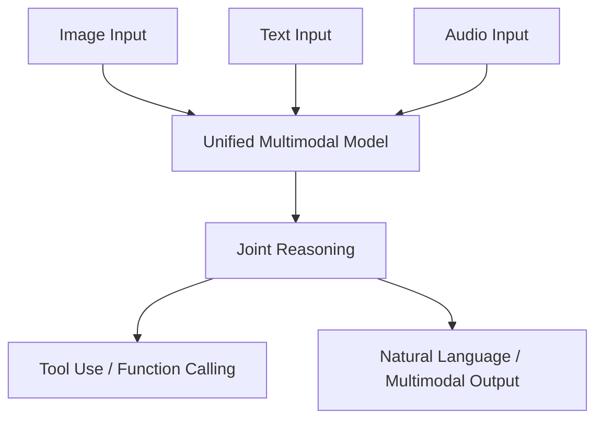
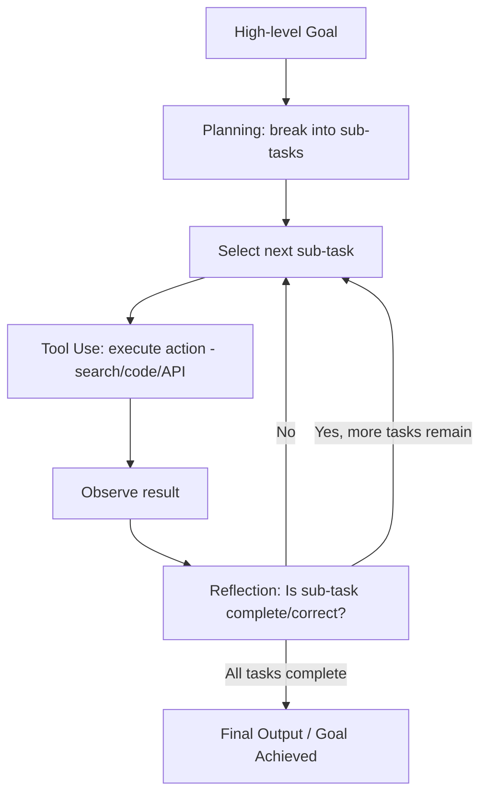

# UNIT V – Multimodal, Ethical & Emerging Applications

> **Syllabus coverage:** Multimodal models (CLIP, Flamingo), Video Generation; Generative models for code (Codex); Agents (AutoGPT); Interpretability and hallucinations; AI alignment, safety, and bias mitigation; Multimodal Agent Systems (GPT-4o, Gemini, Claude 3) — integration of vision + language + tools; Synthetic Data Generation for model training; Legal & Policy Updates (AI Bill of Rights (US), EU AI Act, India's Digital India guidelines on AI); Open-source Trends (Mistral, LLaMA 3, Phi-3, TinyML for generative AI).

**Exam weightage in this unit:** 🟠 **Priority 1/2 (Important, recently tested)** — this unit was fully and heavily tested in the current year's Mid-2 paper (all 5 Part-A sub-topics + both Part-B options drawn directly from this unit), suggesting it is current-faculty-emphasized material. Strongly consider for detailed preparation alongside Units I, III, and IV, especially since it overlaps with current policy/industry trends.

---

## 1. Multimodal Generative Models

### A. Definition
**Multimodal models** are AI models designed to process, understand, and/or generate information across multiple data modalities (e.g., text, images, audio, video) simultaneously, learning joint representations that connect these different types of data.

### B. Simple Explanation
Normal language models only understand text. Multimodal models can look at a picture AND read text AND sometimes listen to audio, combining understanding across all of them — like a person who can both read a caption and look at the photo it describes and connect the two.

### C. Detailed Explanation

**CLIP (Contrastive Language-Image Pre-training):**
- Trained using a **contrastive learning** objective on large datasets of (image, text caption) pairs.
- Consists of an **image encoder** and a **text encoder** that map images and text into a **shared embedding space**, such that matching image-text pairs have high similarity (high dot product/cosine similarity) and non-matching pairs have low similarity.
- Enables zero-shot image classification (classify an image by comparing its embedding to text embeddings of class names) and is widely used as a component in text-to-image generation models (e.g., guiding diffusion models, computing CLIP Score for evaluation).

**Flamingo:**
- A **visual language model** designed for few-shot learning on multimodal tasks (e.g., visual question answering, image captioning), capable of processing interleaved sequences of images and text.
- Combines a pretrained vision encoder with a pretrained language model, connected via specialized cross-attention layers, allowing the language model to "attend to" visual features while generating text.

**Multimodal Agent Systems (GPT-4o, Gemini, Claude 3):**
- These models natively integrate **vision + language (+ sometimes audio)** processing within a single unified architecture, enabling them to accept images, text, and sometimes audio/video as input and reason across modalities jointly (rather than using separate specialized models stitched together).
- Often integrated with **tool use** (function calling, web search, code execution), enabling multimodal reasoning combined with agentic action — e.g., "look at this chart (image), extract the data, and calculate the trend (tool use)."

### D. Diagram

**CLIP:**


**Multimodal Agent (GPT-4o style):**


### E. Comparison Table

| Model | Modality Focus | Key Mechanism | Primary Use |
|---|---|---|---|
| CLIP | Image + Text | Contrastive learning, shared embedding space | Zero-shot classification, text-image alignment scoring |
| Flamingo | Image + Text (few-shot) | Cross-attention between vision encoder and LM | Visual QA, captioning |
| GPT-4o / Gemini / Claude 3 | Vision + Language (+ Audio) + Tools | Unified multimodal architecture + agentic tool use | General-purpose multimodal assistants |

### F. Real-world Example
GPT-4o can look at a photo of a hand-written math problem, read the handwriting (vision), understand the problem (language), and solve it step-by-step (reasoning) — all within a single integrated model.

### G. University Examination Answer — "What are multimodal generative models?" / "Explain the architecture and applications of multimodal AI models such as GPT-4o, Gemini and Claude 3. How do these models integrate vision, language and tools?"
1. **Definition** of multimodal models.
2. **Explain CLIP** (contrastive learning, shared embedding space) with diagram.
3. **Explain integration in GPT-4o/Gemini/Claude 3:** unified architecture processing vision + language (+ audio) jointly, combined with function calling/tool use for agentic behavior.
4. **Applications:** visual question answering, document/chart understanding, accessibility (describing images for visually impaired), multimodal customer support.
5. **Conclusion:** Multimodal models represent a shift from narrow, single-modality AI toward general-purpose assistants capable of perceiving and reasoning across diverse real-world data types.

### H. Important Keywords
Multimodal, CLIP, contrastive learning, shared embedding space, Flamingo, cross-attention, vision encoder, GPT-4o, Gemini, Claude 3, unified architecture.

---

## 2. Generative Models for Code (Codex)

### C. Detailed Explanation
- **Codex** (and similar code-generation models like GitHub Copilot's underlying models) are LLMs fine-tuned specifically on large corpora of source code (in addition to natural language), enabling them to generate, complete, explain, and debug code based on natural language prompts or partial code context.
- Trained using the same causal/autoregressive language modeling objective as text-generating LLMs, but on code repositories, enabling them to learn programming syntax, patterns, libraries, and idioms across multiple programming languages.

### H. Important Keywords
Codex, code generation, autoregressive modeling, GitHub Copilot, code completion.

---

## 3. AI Agents: AutoGPT and Autonomous Task Execution

### A. Definition
**AutoGPT** is an experimental autonomous AI agent framework that uses an LLM to **recursively plan, execute, and self-evaluate** a sequence of tasks toward a high-level goal specified by the user, with minimal human intervention, by chaining together reasoning, tool use, and memory.

### B. Simple Explanation
Instead of asking an AI one question at a time, you give AutoGPT a big goal (e.g., "research and write a report on X"), and it breaks that goal into smaller sub-tasks on its own, works through them one by one (searching the web, writing drafts, checking its own work), and keeps going with minimal human input until the goal is complete.

### C. Detailed Explanation — Role of Planning, Reflection, and Tool Usage in Agentic Systems

1. **Planning:** The agent decomposes a high-level, often vague goal into a sequence of concrete, actionable sub-tasks, deciding the order in which they should be executed.
2. **Tool Usage:** For each sub-task, the agent determines whether it needs an external tool (web search, file read/write, code execution, API call) and invokes it accordingly (similar to function calling, Unit III).
3. **Memory:** The agent maintains both short-term memory (current task context) and sometimes long-term memory (e.g., a vector database of past actions/results) to inform future decisions and avoid repeating work.
4. **Reflection/Self-evaluation:** After executing a sub-task, the agent evaluates whether the result is satisfactory, and can revise its plan, retry a failed step, or re-prioritize subsequent tasks based on this self-assessment — this iterative feedback loop is key to autonomous operation.
5. This continues in a loop until the overall goal is judged complete or a stopping condition (e.g., max iterations) is reached.

### D. Diagram


### F. Real-world Example
AutoGPT given the goal "research competitor pricing and draft a summary report" could autonomously search the web for competitor data, extract relevant pricing information, organize it, and draft a report — executing multiple steps without a human prompting each individual action.

### G. University Examination Answer — "Discuss the role of AI agents such as AutoGPT in autonomous task execution. Explain the importance of planning, reflection and tool usage in agentic systems"
1. **Definition** of AutoGPT/autonomous agents.
2. **Explain the agentic loop:** planning → tool use → memory → reflection (with diagram).
3. **Importance of each component:**
   - Planning: breaks down complexity, ensures logical task ordering.
   - Tool use: extends capability beyond the model's own knowledge/text generation.
   - Reflection: enables error correction and adaptive behavior without human micromanagement.
4. **Example** as above.
5. **Limitations:** can get stuck in loops, may make costly/incorrect autonomous decisions, requires careful guardrails.
6. **Conclusion:** Agentic systems like AutoGPT represent a significant step toward autonomous AI capable of completing complex, multi-step real-world tasks with minimal supervision.

### H. Important Keywords
AutoGPT, autonomous agent, planning, reflection, self-evaluation, memory, recursive task decomposition, agentic loop.

---

## 4. Interpretability, Hallucinations, AI Alignment, Safety, and Bias Mitigation

### A. Definition
**Interpretability** refers to the degree to which the internal workings and decision-making process of an AI model can be understood by humans.

**Hallucination** refers to an LLM generating output that is fluent and confident-sounding but factually incorrect, fabricated, or unsupported by the input/evidence.

**AI alignment** refers to the broader goal of ensuring an AI system's objectives, behaviors, and outputs are consistent with human values, intentions, and safety requirements.

### C. Detailed Explanation

**Hallucinations:**
- Occur because LLMs are fundamentally trained to predict statistically plausible next tokens, not to verify factual truth — a fluent-sounding but false statement can have high probability under the model's learned distribution.
- Mitigation approaches: Retrieval-Augmented Generation (grounding responses in retrieved factual documents), improved training data curation, factuality-focused fine-tuning/RLHF, and explicit uncertainty expression.

**AI Alignment and Safety:**
- Encompasses techniques (like RLHF, DPO, ORPO from Unit III) that steer model behavior toward being helpful, honest, and harmless.
- Includes **red-teaming** (deliberately probing models for harmful or unsafe outputs) and **guardrails** (content filters, refusal mechanisms for unsafe requests).

**Bias Mitigation:**
- LLMs trained on large internet-scale data can inherit and amplify societal biases (e.g., gender, racial, cultural biases) present in training data.
- Mitigation strategies include: curating more balanced/diverse training datasets, bias-auditing tools, fine-tuning on debiasing objectives, and post-hoc output filtering.

**Interpretability:**
- Techniques include attention visualization (seeing which tokens a model "attends to"), probing classifiers (testing what information is encoded in internal representations), and mechanistic interpretability (reverse-engineering specific internal circuits/computations responsible for certain behaviors).
- Important for building trust, debugging model failures, and ensuring regulatory compliance.

### E. Comparison Table

| Concept | What it addresses | Example Mitigation/Technique |
|---|---|---|
| Hallucination | Factually incorrect but fluent output | RAG, factuality fine-tuning |
| Alignment | Matching model behavior to human values | RLHF, DPO, ORPO, red-teaming |
| Bias | Unfair/skewed outputs reflecting training data biases | Diverse datasets, debiasing fine-tuning, auditing |
| Interpretability | Understanding internal model reasoning | Attention visualization, probing, mechanistic interpretability |

### H. Important Keywords
Hallucination, alignment, red-teaming, guardrails, bias mitigation, interpretability, mechanistic interpretability, attention visualization, RAG.

---

## 5. Synthetic Data Generation

### A. Definition
**Synthetic data generation** refers to the process of using generative AI models to create artificial training data that mimics the statistical properties of real-world data, used to augment or substitute real datasets for training other AI models.

### B. Simple Explanation
Instead of (or in addition to) collecting real-world data, you use an AI model to generate realistic fake examples — like having a generative model create thousands of realistic sample customer reviews to train a sentiment classifier, when real labeled reviews are scarce or expensive to obtain.

### C. Detailed Explanation

**Advantages:**
- Reduces dependency on expensive/scarce real-world labeled data collection.
- Helps address data privacy concerns, since synthetic data doesn't directly expose real individuals' sensitive information.
- Can be used to balance underrepresented classes/scenarios in training data (e.g., generating more examples of rare edge cases).
- Enables rapid, scalable dataset creation for fine-tuning and evaluation.

**Limitations/Challenges:**
- Risk of **distribution mismatch** — synthetic data may not perfectly capture the nuances/diversity of real-world data, leading to models that perform worse on real data.
- Risk of **model collapse** — if models are repeatedly trained on data generated by other AI models (recursively), quality and diversity can degrade over successive generations.
- Synthetic data can inherit and amplify biases present in the generating model.
- Requires careful validation to ensure synthetic data is actually useful and representative.

### D. Diagram
```
Real Data (limited/scarce) --> [Generative Model] --> Synthetic Data (augmented) 
                                                              |
Real Data + Synthetic Data --> [Train Downstream Model] --> Improved Model
```

### G. University Examination Answer — "Explain Synthetic Data Generation and its importance in training Generative AI models. Discuss its advantages and limitations"
1. **Definition** as above.
2. **Process/diagram:** generative model creates synthetic data to augment real datasets.
3. **Advantages:** cost reduction, privacy preservation, class balancing, scalability.
4. **Limitations:** distribution mismatch, model collapse risk, bias amplification.
5. **Conclusion:** Synthetic data generation is a valuable but carefully-managed tool for training generative AI models, particularly where real data is scarce, sensitive, or imbalanced.

### H. Important Keywords
Synthetic data, data augmentation, distribution mismatch, model collapse, data privacy, class imbalance.

---

## 6. Legal & Policy Updates in AI

### A. Definition
AI legal and policy frameworks are regulatory guidelines and laws established by governments/institutions to govern the development, deployment, and use of AI systems, addressing concerns such as safety, fairness, transparency, privacy, and accountability.

### C. Detailed Explanation

**AI Bill of Rights (US):**
- A White House framework (non-binding blueprint) outlining five key principles for the ethical and safe use of AI systems: (1) safe and effective systems, (2) protection from algorithmic discrimination, (3) data privacy protections, (4) notice and explanation when AI is used, and (5) the ability to opt out in favor of human alternatives where appropriate.

**EU AI Act:**
- A comprehensive, legally binding regulatory framework from the European Union that classifies AI systems into **risk tiers** (unacceptable risk, high risk, limited risk, minimal risk), with corresponding obligations — unacceptable-risk systems (e.g., social scoring) are banned, high-risk systems (e.g., AI in hiring, credit scoring) face strict compliance requirements (transparency, human oversight, documentation), and minimal-risk systems face few restrictions.

**India's Digital India / AI Guidelines:**
- India's evolving approach to AI governance emphasizes promoting AI innovation and adoption (through initiatives under the broader Digital India program) while gradually developing guidelines/frameworks addressing responsible AI use, data protection (e.g., in conjunction with India's data protection legislation), and ethical considerations, generally favoring a pro-innovation, sector-specific regulatory approach compared to the EU's more prescriptive model.

### E. Comparison Table

| Framework | Region | Nature | Key Approach |
|---|---|---|---|
| AI Bill of Rights | United States | Non-binding guidance/blueprint | Five principles (safety, non-discrimination, privacy, transparency, human alternative) |
| EU AI Act | European Union | Legally binding regulation | Risk-tiered classification (unacceptable/high/limited/minimal risk) |
| India's Digital India AI guidelines | India | Evolving, pro-innovation guidance | Innovation-friendly, sector-specific, gradually formalizing |

### G. University Examination Answer — "Discuss the ethical, legal and policy challenges associated with Generative AI, with reference to the EU AI Act, India's Digital India guidelines, AI Bill of Rights and open-source models such as Mistral and LLaMA 3"
1. **Introduction:** Generative AI's rapid growth has raised ethical/legal challenges — bias, misinformation, copyright, privacy, accountability.
2. **EU AI Act:** explain risk-tiered regulatory approach.
3. **AI Bill of Rights (US):** explain the five non-binding principles.
4. **India's approach:** innovation-focused, evolving guidelines under Digital India.
5. **Open-source trends (Mistral, LLaMA 3) and policy tension:** open-source models raise unique policy questions around misuse potential vs. the benefits of transparency, accessibility, and democratization of AI research — regulators are still determining how open-weight models should be treated differently from closed, API-only models.
6. **Comparison table** as above.
7. **Conclusion:** Different regions are adopting varied regulatory philosophies (binding risk-based regulation vs. non-binding principles vs. innovation-first guidance), reflecting the global challenge of balancing AI innovation with safety, fairness, and accountability.

### H. Important Keywords
AI Bill of Rights, EU AI Act, risk-tiered regulation, algorithmic discrimination, Digital India, data protection, open-weight models, responsible AI.

---

## 7. Open-Source Trends: Mistral, LLaMA 3, Phi-3, TinyML for Generative AI

### C. Detailed Explanation
- **Mistral:** A family of open-weight LLMs (including Mixtral's MoE-based models) known for strong performance relative to their size, promoting accessible, efficient open-source generative AI.
- **LLaMA 3:** Meta's open-weight large language model family, widely used as a base for fine-tuning/research due to its strong performance and open availability.
- **Phi-3:** Microsoft's family of smaller, highly capable "small language models" (SLMs) trained on carefully curated, high-quality data, demonstrating that smaller models can achieve strong performance through better data curation rather than just scale.
- **TinyML for Generative AI:** Refers to techniques and research enabling generative AI capabilities to run on extremely resource-constrained edge devices (microcontrollers, IoT devices) through aggressive model compression, quantization, and architecture optimization — extending generative AI beyond cloud/data-center deployment to on-device applications.

### E. Comparison Table

| Trend | Organization | Key Characteristic |
|---|---|---|
| Mistral / Mixtral | Mistral AI | Open-weight, efficient (including MoE architecture) |
| LLaMA 3 | Meta | Open-weight, widely used research/fine-tuning base |
| Phi-3 | Microsoft | Small Language Model (SLM), high-quality curated training data |
| TinyML for GenAI | Various (research community) | Extreme compression for edge/on-device deployment |

### H. Important Keywords
Open-weight models, Mistral, Mixtral, LLaMA 3, Phi-3, Small Language Model (SLM), TinyML, edge deployment, model compression.

---

## Quick Revision Summary (Unit V)

| Topic | One-line Recall |
|---|---|
| CLIP | Contrastive learning; shared image-text embedding space |
| Flamingo | Few-shot visual-language model via cross-attention |
| GPT-4o/Gemini/Claude 3 | Unified multimodal models + tool use |
| Codex | Code-generation LLM, trained on source code |
| AutoGPT | Autonomous agent: plan → act (tools) → reflect loop |
| Hallucination | Fluent but factually incorrect output |
| Alignment | RLHF/DPO/ORPO + red-teaming to match human values |
| Bias mitigation | Diverse data, debiasing fine-tuning, auditing |
| Synthetic data | AI-generated training data; risk: model collapse |
| AI Bill of Rights | US, non-binding, 5 principles |
| EU AI Act | Binding, risk-tiered (unacceptable/high/limited/minimal) |
| India Digital India AI | Innovation-first, evolving, sector-specific |
| Mistral/LLaMA 3/Phi-3 | Open-weight models; Phi-3 = small but high-quality data |
| TinyML for GenAI | Compressed generative AI for edge devices |
